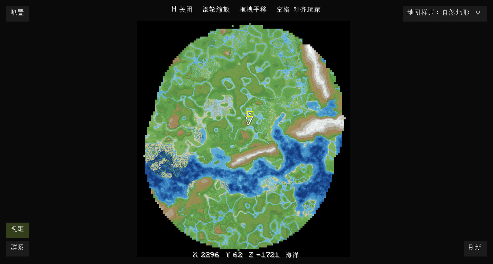
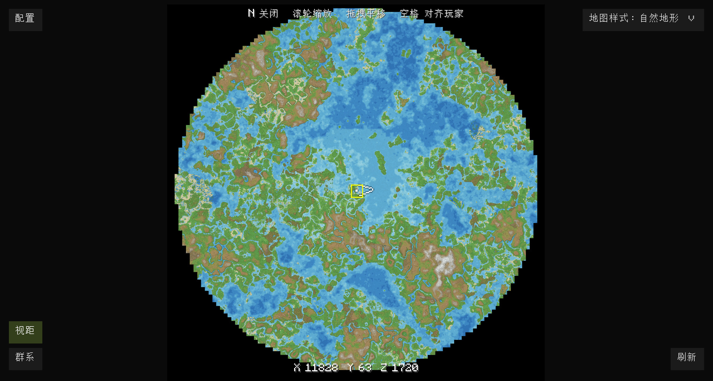
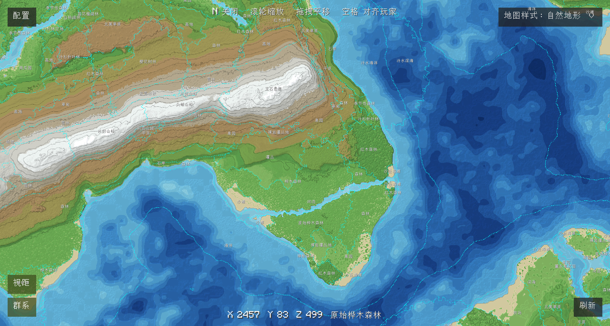

# Voxy Map

<p align="left"></p>

**[English](#voxy-map)** | [简体中文](#简体中文)

**The whole world on one map: Voxy Map reads Voxy's level-of-detail data directly — no chunk loading, no flying around — and renders a full-screen terrain map in about a second.**

A Minecraft world map mod (mod id `voxymap`). Currently supports **Minecraft 1.21.1 NeoForge**, client-side only; other versions and loaders are planned.

Best used together with **Voxy SeedGen** — it pre-generates distant terrain from the world seed so the map actually covers the world:

- Voxy SeedGen: <https://modrinth.com/mod/voxy-seedgen>

---

## Screenshots

### Six palettes

Tectonic mod with the "i use voxy btw" preset; Voxy SeedGen distance 382 chunks, yellow box = actual render distance (natural / gradient / GMT / nautical / gradient-turbo / gradient-soft):


Vanilla terrain, same set of palettes, with biome boundaries and biome labels:


### Fullscreen map

Tectonic mod with the "i use voxy btw" preset; Voxy SeedGen distance 382 chunks, yellow box = actual render distance:



Vanilla terrain, Voxy SeedGen distance 382 chunks, yellow box = actual render distance:



Close-up: contour lines, hillshade, water-depth shading, biome boundaries and labels:



## Features

**Map and interaction**

- **N** opens/closes the fullscreen map, **Space** re-centres on the player, scroll to zoom, drag to pan
- Render-distance box, cursor coordinates and biome name, right-click menu (copy coordinates / teleport / export PNG)
- UI buttons: "Config" (top-left), palette dropdown (top-right), "Render distance" / "Biomes" toggles (bottom-left), "Refresh" (bottom-right)

**Rendering**

- Six palettes: natural, gradient, GMT, nautical, gradient-turbo, gradient-soft
- Contour lines, hillshade, water-depth shading, ocean blur, hole filling, optional denoise, adaptive colour ramp
- Biome boundary overlay and biome labels (small regions filtered by area)

**Data and performance**

- Decodes Voxy's LOD storage and merges every level — **no chunk loading**
- Automatic refresh when the player moves far; one disk cache per world (`voxymap-cache/`), so reopening is instant
- Releases its textures when the map is closed

**Almost everything is configurable** — in game under "Mods → Voxy Map → Config", or in `config/voxymap-client.toml`.

## Requirements

| Dependency | Version | Necessity | Notes |
| --- | --- | --- | --- |
| Minecraft | 1.21.1 | Required | The game itself |
| NeoForge | 21.1.224+ | Required | Mod loader; Roxy requires 21.1.224+, this project targets 21.1.217 |
| [Voxy](https://modrinth.com/mod/voxy) | 0.2+ | Required | Source of the map data: this mod reads its LOD storage |
| [Roxy](https://modrinth.com/mod/roxy) | 0.4+ | Required (not needed when a third-party Voxy port is used) | Bridges the Fabric Voxy onto NeoForge; Voxy does not run without it |
| Sodium | 0.6.13+ | Required | Rendering dependency of Voxy (declared by Roxy) |
| [Voxy SeedGen](https://modrinth.com/mod/voxy-seedgen) | 0.3+ | Recommended (optional) | Pre-generates distant terrain from the seed; without it the map only covers areas you actually explored |

> This is a client-side mod. It relies on Voxy through the Roxy bridge; other third-party Voxy ports are untested.

Tested with: Minecraft 1.21.1 / NeoForge 21.1.265, Voxy 0.2.16-beta (via Roxy 0.4.1), Voxy SeedGen 0.3.1.

## Installation

1. Install Minecraft 1.21.1 and NeoForge 21.1.224+
2. Install the prerequisites: Voxy, Roxy, Sodium (plus SeedGen, recommended)
3. Download `voxy-map-x.y.z.jar` from [Releases](https://github.com/Tsutsutsuu/voxy-map/releases) and drop it into the instance's `mods` folder
4. Launch the game and press **N**

The first open reads Voxy's storage and renders (about a second depending on the explored area); after that it uses the disk cache.

## Controls

| Action | Default key |
| --- | --- |
| Open / close map | `N` |
| Re-centre on the player | `Space` |
| Zoom | Mouse wheel |
| Pan | Hold the left mouse button and drag |
| Map menu | Right mouse button (copy coordinates / teleport / export PNG) |
| Close map | `Esc` |

Both key bindings can be changed in **Options → Controls → Key Binds → Voxy Map**.

"Teleport" in the right-click menu requires OP permission (can be disabled in the config); "Export PNG" saves the current map to `voxymap-exports/` in the instance folder.

## Configuration

Every option has a bilingual comment and can be edited in the in-game config screen, or directly in the instance's `config/voxymap-client.toml`. Common options:

| Option | Default | Description |
| --- | --- | --- |
| `pixelBlocks` | 2 | Blocks per pixel (1 = sharpest and slowest, 4 = coarser and faster) |
| `maxLodLevel` | 4 | Highest Voxy LOD level to merge (0–4) |
| `defaultStyle` | `current` | Default palette |
| `defaultZoom` | 0.5 | Initial zoom when opening the map |
| `autoRefresh` / `refreshDistanceChunks` | `true` / 128 | Refresh once the player moved this many chunks |
| `initialRefreshDelayMinutes` | 3 | Refresh this many minutes after joining a world (gives SeedGen time) |
| `drawContours` / `contourDensity` | `true` / 12 | Contours on/off and their density |
| `drawHillshade` / `drawWaterDepth` | `true` / `true` | Hillshade / water-depth shading |
| `waterBlur` / `waterBlurRadius` | `true` / 8 | Ocean blur |
| `fillHoles` / `denoise` | `true` / `false` | Hole filling / denoise |
| `showBiomes` / `biomeLabelMinArea` | `false` / 600 | Biome overlay / minimum label area (pixels) |
| `releaseTexturesOnClose` | `true` | Release textures when the map is closed |

## FAQ

**The map is empty or only partially filled?**
Make sure Voxy and Roxy are installed. Without SeedGen the map only covers the data Voxy has already stored, so unexplored edges stay empty — that is expected.

**The data changed but the map is still old?**
The disk cache does not invalidate automatically. Click "**Refresh**" in the bottom-right corner to rebuild it.

**Biomes differ from what F3 shows?**
With `pixelBlocks = 2` one pixel represents 2×2 blocks, so borders may take the neighbouring column. Lower `pixelBlocks` and refresh for a sharper map.

**Memory / VRAM usage seems high?**
Texture size grows with the explored area. Closing the map releases textures by default (`releaseTexturesOnClose`).

## Known limitations

- The cache does not invalidate when Voxy's data changes (refresh the map manually)
- Caches are not removed when a world is deleted (clean them up manually; the files are small)
- Biomes are resolved by registry path, so mods with identically named biomes may show the wrong one (unlikely)
- The biome overlay uses a full-resolution texture and takes noticeable memory/VRAM while enabled

## Building from source

Requires JDK 21:

```bash
cd mod
./gradlew build
```

On Windows use `.\gradlew.bat build`. Output: `mod/build/libs/voxy-map-0.1.0.jar`.

> Behind a restrictive network Gradle needs a proxy; see `systemProp.https.proxyHost` / `proxyPort` in `mod/gradle.properties`.

<details>
<summary>Repository layout and offline POC tools (developers)</summary>

```
voxy-map/
├── mod/                  Gradle project (sources + build scripts)
│   ├── src/main/java/com/voxymap/   mod sources
│   ├── src/main/resources/          resources (lang, textures, icon)
│   ├── build.gradle / gradle.properties / settings.gradle
│   ├── gradle/ gradlew gradlew.bat  build wrapper
│   └── libs/            rocksdbjni compile-only dependency (not bundled)
├── poc/                  offline tools (single-file Java, POC and data diagnostics)
└── img/                 README screenshots (raw/ holds local originals, not committed)
```

The tools in `poc/` read an instance's Voxy storage offline to render/diagnose the map. They need rocksdbjni 10.2.1 and zstd-jni 1.5.6-3:

```powershell
java -Xmx8G -cp "<rocksdbjni>;<zstd-jni>;out" VoxyMapPoC10 "<storage dir>" out.png 2 63 4 current
```

</details>

## License

MIT — see [LICENSE](LICENSE).

Icon and screenshots © Tsutsutsu; map data comes from Voxy and its SeedGen add-on.

---

# 简体中文

[English](#voxy-map) | **[简体中文](#简体中文)**

**把整个世界画成一张地图：直接读取 Voxy 的 LOD 数据，不加载区块、不跑图，秒级生成全屏地形图。**

一个 Minecraft 世界地图模组（mod id `voxymap`）。目前支持 **Minecraft 1.21.1 NeoForge**，纯客户端；其他版本/加载器支持计划中。

配合 **Voxy SeedGen** 使用效果最佳 —— 它按世界种子预生成远景数据，地图才完整：

- Voxy SeedGen：<https://modrinth.com/mod/voxy-seedgen>

---

## 截图

### 6 种配色

使用 Tectonic Mod 的 "i use voxy btw" 预设地形，Voxy SeedGen 距离 382 区块，黄色框为真实渲染距离（自然地形 / 渐变 / GMT / 航海 / 彩虹渐变 / 柔和渐变）：


原版地形，同一组配色，带群系边界与群系名标签：


### 全屏地图

使用 Tectonic Mod 的 "i use voxy btw" 预设地形，Voxy SeedGen 距离 382 区块，黄色框为真实渲染距离：


原版地形，Voxy SeedGen 距离 382 区块，黄色框为真实渲染距离：


近景细节：等高线、山体阴影、水深着色、群系边界与标签：


## 功能概览

**地图与交互**

- 按 **N** 打开/关闭全屏地图，**空格**对准玩家，滚轮缩放，拖拽平移
- 视距框、鼠标坐标与群系显示，右键菜单（复制坐标 / 传送 / 导出 PNG）
- 界面按钮：左上「配置」、右上「地图样式」下拉、左下「视距」「群系」开关、右下「刷新」

**渲染**

- 6 种配色：自然地形、渐变、GMT、航海、彩虹渐变、柔和渐变
- 等高线、山体阴影、水深着色、海洋模糊、补洞、可选去噪、自适应色带
- 群系边界叠加 + 群系名标签（按区域面积过滤小群系）

**数据与性能**

- 直接解码 Voxy 的 LOD 存储并合并所有层级，**不加载区块**
- 玩家移动较远时自动刷新；每个存档一份磁盘缓存（`voxymap-cache/`），重开秒进
- 关闭地图自动释放纹理

**几乎都能配置** —— 游戏内「模组 → Voxy Map → 配置」，或 `config/voxymap-client.toml`。

## 前置要求

| 依赖 | 版本 | 必需性 | 说明 |
| --- | --- | --- | --- |
| Minecraft | 1.21.1 | 必需 | 游戏本体 |
| NeoForge | 21.1.224+ | 必需 | 模组加载器；Roxy 要求 21.1.224+，本项目编译目标为 21.1.217 |
| [Voxy](https://modrinth.com/mod/voxy) | 0.2+ | 必需 | 提供地图数据：本模组直接读取它的 LOD 存储 |
| [Roxy](https://modrinth.com/mod/roxy) | 0.4+ | 必需/使用第三方移植Voxy时不必须 | 把 Fabric 版 Voxy 加载到 NeoForge 的桥接层，没有它 Voxy 无法运行 |
| Sodium | 0.6.13+ | 必需 | Voxy 的渲染依赖（由 Roxy 的依赖声明要求） |
| [Voxy SeedGen](https://modrinth.com/mod/voxy-seedgen) | 0.3+ | 推荐（可选） | 按世界种子预生成远景；不装时地图只覆盖你实际探索过的区域 |

> 本模组为纯客户端模组。依赖的是使用 Roxy 翻译层的 Voxy，其他第三方 Voxy 移植版本未测试。

已验证环境：Minecraft 1.21.1 / NeoForge 21.1.265、Voxy 0.2.16-beta（经 Roxy 0.4.1 桥接）、Voxy SeedGen 0.3.1。

## 安装

1. 安装 Minecraft 1.21.1 与 NeoForge 21.1.224+
2. 安装前置：Voxy、Roxy、Sodium（推荐再加 SeedGen）
3. 从 [Releases](https://github.com/Tsutsutsuu/voxy-map/releases) 下载 `voxy-map-x.y.z.jar`，放进实例的 `mods` 目录
4. 启动游戏，按 **N** 打开地图

首次打开需要读取 Voxy 存储并渲染（视探索范围约 1 秒），之后走磁盘缓存。

## 使用

| 操作 | 默认按键 |
| --- | --- |
| 打开 / 关闭地图 | `N` |
| 对准玩家位置 | `空格` |
| 缩放 | 鼠标滚轮 |
| 平移 | 按住鼠标左键拖拽 |
| 地图菜单 | 鼠标右键（复制坐标 / 传送 / 导出 PNG） |
| 关闭地图 | `Esc` |

两个按键都可改：**选项 → 控制 → 按键绑定 → Voxy Map**。

右键菜单里的「传送」需要 OP 权限（可在配置里关闭），「导出 PNG」把当前地图保存到实例的 `voxymap-exports/` 目录。

## 配置

所有选项都带中英双语注释，可在游戏内配置界面修改，或直接编辑实例的 `config/voxymap-client.toml`。常用项：

| 配置项 | 默认 | 说明 |
| --- | --- | --- |
| `pixelBlocks` | 2 | 每像素方块数（1 最精细也最慢，4 更粗更快） |
| `maxLodLevel` | 4 | 合并的最高 Voxy LOD 层级（0–4） |
| `defaultStyle` | `current` | 默认配色 |
| `defaultZoom` | 0.5 | 打开地图时的缩放 |
| `autoRefresh` / `refreshDistanceChunks` | `true` / 128 | 玩家移动超过 N 区块后自动刷新 |
| `initialRefreshDelayMinutes` | 3 | 进世界多少分钟后刷新一次（留时间给 SeedGen） |
| `drawContours` / `contourDensity` | `true` / 12 | 等高线开关与密度 |
| `drawHillshade` / `drawWaterDepth` | `true` / `true` | 山体阴影 / 水深着色 |
| `waterBlur` / `waterBlurRadius` | `true` / 8 | 海洋模糊 |
| `fillHoles` / `denoise` | `true` / `false` | 补洞 / 去噪 |
| `showBiomes` / `biomeLabelMinArea` | `false` / 600 | 群系叠加开关 / 标签最小面积（像素） |
| `releaseTexturesOnClose` | `true` | 关闭地图时释放纹理 |

## 常见问题

**地图打不开 / 只显示一部分？**
先确认 Voxy 与 Roxy 已装好。没有 SeedGen 时，地图只覆盖 Voxy 已存下的数据，边缘未探索的区域是空的，属于正常现象。

**数据更新了但地图还是旧的？**
磁盘缓存不会自动失效，点右下角「**刷新**」强制重建即可。

**群系和 F3 显示的不一致？**
`pixelBlocks = 2` 时一个像素代表 2×2 方块，边界处可能取到相邻列。把 `pixelBlocks` 调小并刷新会更精细。

**内存/显存占用偏高？**
纹理尺寸随探索范围增长；关闭地图默认会释放纹理（`releaseTexturesOnClose`），也可以打开群系叠加前先确认显存充足。

## 已知限制

- 缓存不随 Voxy 数据变化自动失效（需手动刷新地图）
- 缓存不随存档删除自动移除（需手动清理，但文件很小）
- 群系按注册名 path 反查，多个模组存在同名群系时可能显示错误（概率低）
- 群系边界叠加使用全分辨率纹理，开启时会占用较多内存/显存

## 从源码构建

需要 JDK 21：

```bash
cd mod
./gradlew build
```

Windows 用 `.\gradlew.bat build`。产物：`mod/build/libs/voxy-map-0.1.0.jar`。

> 国内网络下 Gradle 需要代理，可参考 `mod/gradle.properties` 里的 `systemProp.https.proxyHost` / `proxyPort` 配置。

<details>
<summary>仓库结构与离线 POC 工具（开发者）</summary>

```
voxy-map/
├── mod/                  Gradle 工程（源码 + 构建脚本）
│   ├── src/main/java/com/voxymap/   模组源码
│   ├── src/main/resources/          资源（lang、纹理、图标）
│   ├── build.gradle / gradle.properties / settings.gradle
│   ├── gradle/ gradlew gradlew.bat  构建包装器
│   └── libs/            rocksdbjni 编译依赖（compileOnly，运行时不打包）
├── poc/                 离线验证工具（Java 单文件，POC 与数据诊断）
└── img/                 README 截图（raw/ 为本地原图，不入库）
```

`poc/` 里的工具可以直接读取实例的 Voxy storage 离线渲染/诊断地图，编译运行需要 rocksdbjni 10.2.1 与 zstd-jni 1.5.6-3：

```powershell
java -Xmx8G -cp "<rocksdbjni>;<zstd-jni>;out" VoxyMapPoC10 "<storage目录>" out.png 2 63 4 current
```

</details>

## 许可证

本项目采用 **MIT** 许可证，详见 [LICENSE](LICENSE)。

图标与截图 © Tsutsutsu；地图数据来自 Voxy 与其 SeedGen 插件。
