# Voxy Map

<p align="left">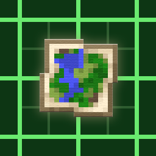</p>

**[English](#voxy-map)** | [简体中文](#简体中文)

***What you see is what you get*** — the map draws exactly as far as you can see: it reads Voxy's level-of-detail data directly, loads no chunks, generates nothing, and turns the visible world into a full-screen terrain map.

A Minecraft world map mod (mod id `voxymap`), client-side only. Currently supports: **Fabric 26.2, Fabric 26.1.2, NeoForge 1.21.1.**

Best used together with **Voxy SeedGen** — it pre-generates distant terrain from the world seed, so the map can be drawn even where chunks were never really loaded:

- Voxy SeedGen: <https://modrinth.com/mod/voxy-seedgen>

---

## Screenshots

### Six palettes

**Tectonic mod** with the "i use voxy btw" preset; Voxy SeedGen distance 382 chunks, yellow box = actual render distance (natural / gradient / GMT / nautical / gradient-turbo / gradient-soft):

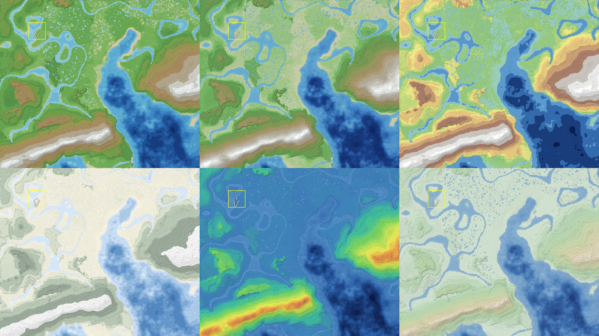

**Vanilla terrain**, same set of palettes, with biome boundaries and biome labels:

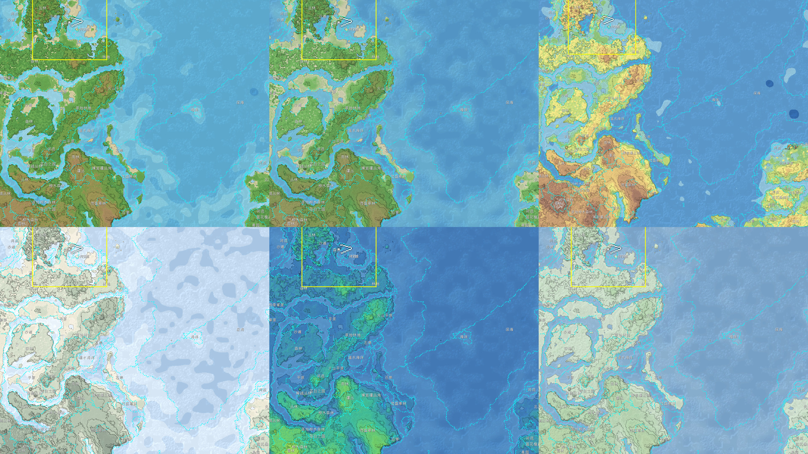

### Fullscreen map

**Tectonic mod** with the "i use voxy btw" preset; Voxy SeedGen distance 382 chunks, yellow box = actual render distance:

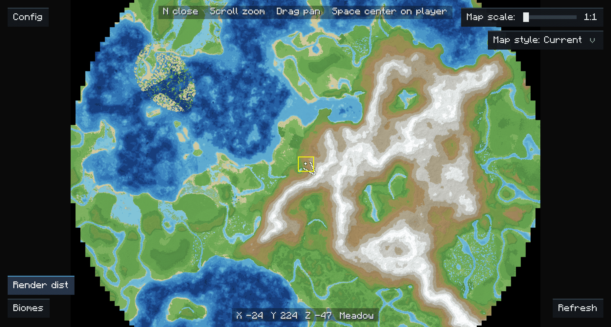

Close-up: contour lines, hillshade, water-depth shading, biome boundaries and labels:

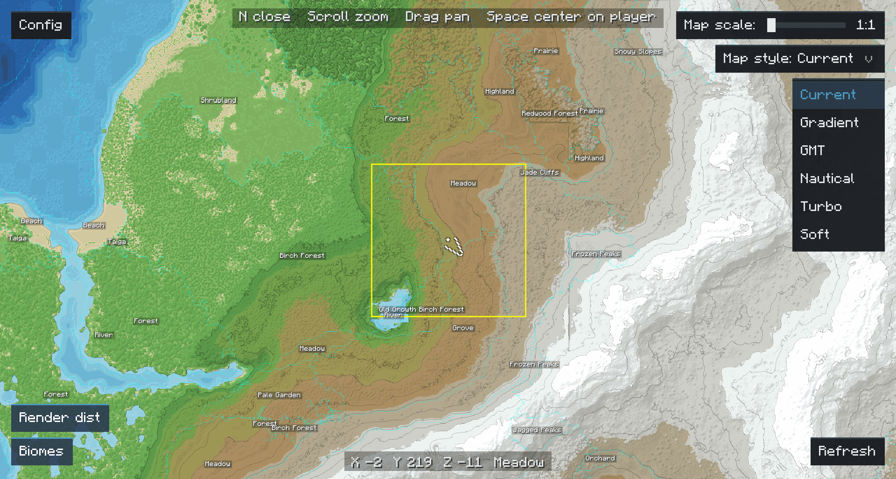

**Vanilla terrain**, Voxy SeedGen distance 382 chunks, yellow box = actual render distance:

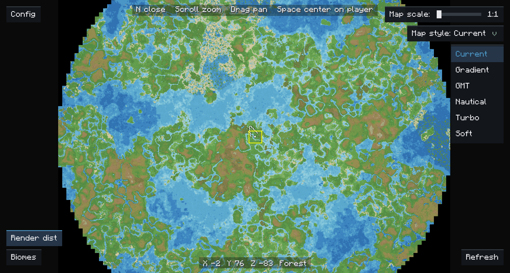

Close-up: contour lines, hillshade, water-depth shading, biome boundaries and labels:

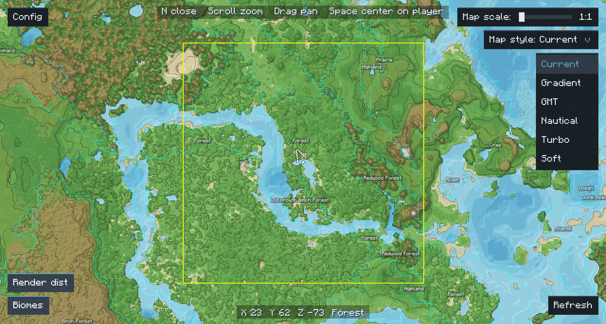

## Features

**Map and interaction**

- **N** opens/closes the fullscreen map, **Space** re-centres on the player, scroll to zoom (interpolated, anchored on the cursor), drag to pan
- Top-right: a **map scale slider** (1:1 – 1:8, rebuilds on release) and the "Map style" dropdown
- Render-distance box, cursor coordinates and biome name, right-click menu (copy coordinates / teleport / export PNG)
- "Config" (top-left), "Render distance" / "Biomes" toggles (bottom-left), "Refresh" (bottom-right)
- **Every world remembers** its own map scale, palette, overlay toggles and zoom
- Opening/closing the map has a smooth scale animation (time driven, so high frame rates do not speed it up)

**Rendering**

- Six palettes: natural, gradient, GMT, nautical, gradient-turbo, gradient-soft
- Contour lines, hillshade, water-depth shading, ocean blur, hole filling, optional denoise, adaptive colour ramp, land ramp stretching
- Biome boundaries (a 75% / 25% opacity checkerboard) and biome labels (placed at the **centre of the largest inscribed circle** of each region, filtered by area, hidden when a button, menu or text plate would cover them)
- Unified dark translucent UI: buttons 75%, floating menus 88%, dialogs 90%, info plates 40%, with smooth accent-tint hover animations

**3D view** (Fabric 26.2 / 26.1.2 / NeoForge 1.21.1)

- **3D** button next to the style selector: an orbitable height-field view built from the same map data (a second rendering mode of the map, not a separate world render)
- GPU per-tile terrain: every map tile is meshed on a background worker into one immutable vertex/index buffer plus a 256×256 slot in a 1024×1024 texture atlas, then drawn with Minecraft's own block pipeline in a dedicated render pass (above the world, below the GUI)
- Three mesh precision levels — near step 1 (≤512 blocks), mid step 4 (≤2048), far step 32 (beyond), measured from the real camera eye; the map is first filled at the far step and then refined, with a 15% hysteresis to avoid rebuild churn; vertical skirts (16 blocks by default) hide the seams
- Independent D32_FLOAT depth buffer with reversed-Z depth testing, frustum culling and back-face culling
- Atlas memory is bounded by the tile-texture VRAM budget (256 MB → 1024 tiles); the farthest tiles are evicted first, and the debug panel (`Q`) reports `mesh` / `atlas` / `depth` VRAM separately
- Full-bright by design: the terrain reuses the unlit 2D map colours, so the 3D view does not dim with time of day
- 3D biome labels (distance limit + terrain occlusion), a player arrow that floats above the terrain, ray-picked cursor coordinates and the same right-click menu (picks are clipped to the mapped area, so the sky or the area outside the map no longer yields fake coordinates)
- Seamless 2D↔3D switch (position and scale match), a short rotation animation on exit, and a per-world remembered camera
- **Middle mouse button**: a short click toggles between 2D and 3D, holding and dragging orbits the 3D camera (the two gestures are told apart by press duration and movement, so a drag never switches the view)
- **Space** smoothly animates the view onto the player in both 2D and 3D (a 0.22 s eased pan, same duration and easing as the 3D exit; any manual pan, orbit or zoom cancels it)
- `keep3dTilesIn2d` keeps the built GPU terrain when returning to 2D, so re-entering 3D is instant (at the cost of VRAM)

**Config screen**

- Fully self-drawn in-game config screen: six tabs (General / Map / Map data / 3D View / Perf / Debug), a description for every row, section dividers
- Toggles, dropdowns and sliders (drag, or click the value and type a number)
- **Draft mode**: Cancel discards, Apply saves without closing, Done saves and closes, Reset restores the defaults
- Open/close fade, options fading in one after another on tab switches, animated hover
- The NeoForge build uses a self-drawn screen as well and writes TOML; Fabric writes JSON

**Data and performance**

- Decodes Voxy's LOD storage and merges every level — **no chunk loading**
- **Pauses world rendering** while the map is open (`skipWorldRender`), so the frame budget goes to the map
- Tiles update live from Voxy's section stream; one cache directory per world `voxymap-cache/<hash>/` (`tiles/*.vxt` + `source-index.bin` + `state.properties`; the old `map.vxm`/`color.vxc` files are only used by the retired global path)
- After a restart the first open reuses `color.vxc` and **skips re-rendering**, usually 1–2 s
- Shows the 1/4-resolution copy first while the big texture is built in the background; closing releases only the big texture and keeps the small one, so reopening is instant
- The biome mask and labels are also built in the background — enabling the overlay no longer stutters

## Compatibility

**Languages** — the interface ships in **English, 简体中文, 繁體中文, 日本語, Русский, Deutsch, Français, Español, Português (BR)** (9 languages) and follows the game language. Every label is a translation key, so a resource pack can override or add languages. Biome names come from the game's own language entries, including modded biomes.

**Terrain mods** — the sea level is read from the world (`autoSeaLevel`) and the colour ramp stretches to the world's actual height range (`adaptiveColorRamp`, `landMaxRamp`), so custom terrain generators keep a correct coastline and colour spread instead of being flattened by fixed vanilla heights. The terrain in the screenshots is generated by the Tectonic mod.

**Biome mods** — biome names and boundaries are read from the biome data Voxy stored for the world. Modded biomes are resolved through the client biome registry, so their names show up and are translated when the mod ships a language file.

## Requirements

**Fabric (26.2 / 26.1.2)**

| Dependency | Version | Necessity | Notes |
| --- | --- | --- | --- |
| Minecraft | 26.2 or 26.1.2 | Required | Must match the downloaded jar |
| Fabric Loader | 0.19.5+ | Required | Mod loader |
| Fabric API | Matching version (26.2: 0.161.0+26.2; 26.1.2: 0.155.3+26.1.2) | Required | Key bindings, lifecycle events, etc. |
| [Voxy](https://modrinth.com/mod/voxy) | Matching Fabric version | Required | Source of the map data: this mod reads its LOD storage |
| [Mod Menu](https://modrinth.com/mod/modmenu) | Matching version | Optional | Not needed to play; adds a "Config" entry to the mod list |
| [Voxy SeedGen](https://modrinth.com/mod/voxy-seedgen) | 0.3+ | Recommended (optional) | Pre-generates distant terrain from the seed; without it the map only covers areas you actually explored |

**NeoForge (1.21.1)**

| Dependency | Version | Necessity | Notes |
| --- | --- | --- | --- |
| Minecraft | 1.21.1 | Required | The game itself |
| NeoForge | 21.1.224+ | Required | Mod loader |
| [Voxy](https://modrinth.com/mod/voxy) | 0.2+ | Required | Source of the map data |
| [Roxy](https://modrinth.com/mod/roxy) | 0.4+ | Required (not needed when a third-party Voxy port is used) | Bridges the Fabric Voxy onto NeoForge |
| Sodium | 0.6.13+ | Required | Rendering dependency of Voxy (declared by Roxy) |
| [Voxy SeedGen](https://modrinth.com/mod/voxy-seedgen) | 0.3+ | Recommended (optional) | Distant terrain pre-generation |

> This is a client-side mod; it does not need to be installed on the server.

Tested with: Fabric 26.2 / Loader 0.19.5 / Voxy 0.2.19-beta, Fabric 26.1.2 / Loader 0.20.1 / Voxy 0.2.18-beta, NeoForge 21.1.265 / Voxy 0.2.16-beta (via Roxy 0.4.1); all three also ran Voxy SeedGen 0.3.1.

## Installation

1. Install Minecraft and the loader for your platform (Fabric 26.2 / 26.1.2, or NeoForge 1.21.1)
2. Install the prerequisites from the tables above (Fabric: Fabric API + Voxy; NeoForge: Voxy, Roxy, Sodium)
3. Download the matching jar from [Releases](https://github.com/Tsutsutsuu/voxy-map/releases) and drop it into the instance's `mods` folder:
   - `voxy-map-x.y.z+26.2+fabric.jar` (Fabric 26.2)
   - `voxy-map-x.y.z+26.1.2+fabric.jar` (Fabric 26.1.2)
   - `voxy-map-x.y.z+1.21.1+neoforge.jar` (NeoForge 1.21.1)
4. Launch the game and press **N**

The first open reads Voxy's storage and renders — around 10–20 s depending on the explored area (the result is written to `color.vxc`). After a restart it only reads the cache, usually **1–2 s**; opening and closing the map inside the same game session is instant.

## Controls

| Action | Default key |
| --- | --- |
| Open / close map | `N` |
| Re-centre on the player | `Space` |
| Zoom | Mouse wheel |
| Pan | Hold the left mouse button and drag |
| Map menu | Right mouse button (copy coordinates / teleport / export PNG) |
| Debug panel | `Q` (`debugEnabled`, on by default) |
| Close map | `Esc` |

Both key bindings can be changed in **Options → Controls → Key Binds → Voxy Map**.

The "Map scale" slider in the top-right only changes the readout while dragging; the map rebuilds at the new scale **when the mouse is released**, and the slider stays locked while the build runs.

"Teleport" in the right-click menu requires OP permission (can be disabled in the config); "Export PNG" saves the current map to `voxymap-exports/` in the instance folder.

**Config screen**: `Esc`, `Cancel` and `Done` return to the map (they never close it); `Reset` restores the defaults without saving; only `Apply` / `Done` write the config.

## Configuration

Every option can be changed in the self-drawn in-game config screen (Fabric: "Config" in Mod Menu or the top-left button on the map; NeoForge: "Config" in the mod list or the map button), or by editing the file directly:

- Fabric: `config/voxymap-client.json`
- NeoForge: `config/voxymap-client.toml`

The in-game screen groups options into six tabs (General / Map / Map data / 3D View / Perf / Debug). In the NeoForge TOML the keys are grouped into `ui` / `map` / `data` / `view3d` / `perf` / `debug` (plus a retired `legacy` section that is hidden from the screen); the Fabric JSON is a flat key list. Common ones:

| Option | Group | Default | Description |
| --- | --- | --- | --- |
| `liveTiles` | data | `true` | Stream Voxy section updates into the 2D tiles live (there is no global auto refresh any more) |
| `mapScale` | data | 2 | Map scale 1–8 (1:1 sharpest and slowest, 1:8 coarsest and fastest) |
| `maxLodLevel` | data | 4 | Highest Voxy LOD level to merge (0–4) |
| `cacheKeepCount` / `diskCacheMaxMb` | data | 5 / 8192 | How many world caches to keep (1–100) / disk cache limit per world (MB) |
| `autoSeaLevel` / `seaLevelOverride` | data | `true` / 63 | Read the sea level from the world / manual sea level |
| `defaultStyle` | rendering | `current` | Default palette for new worlds |
| `defaultZoom` / `rememberZoom` | rendering | 0.5 / `true` | Default map zoom / remember the zoom when the map is closed |
| `drawContours` / `contourDensity` / `minContourArea` | rendering | `true` / 12 / 40 | Contours on/off, density and minimum fragment area |
| `drawHillshade` / `drawWaterDepth` | rendering | `true` / `true` | Hillshade / water-depth shading |
| `adaptiveColorRamp` / `landMaxRamp` | rendering | `true` / `true` | Adaptive ramp / stretch the land ramp to the map's highest point |
| `waterBlur` / `waterBlurRadius` / `waterBlurPasses` | rendering | `true` / 8 / 2 | Ocean blur |
| `denoise` / `fillHoles` | rendering | `false` / `false` | Denoise / hole filling |
| `showBiomes` / `biomeLabelMinArea` / `biomeLabelBackground` | rendering | `false` / 600 / `true` | Biome overlay, label minimum area, label background |
| `arrowStyle` / `showRenderDistance` | rendering | `clean` / `false` | Arrow style / render-distance box |
| `releaseTexturesOnClose` / `skipWorldRender` | rendering | `true` / `true` | Release the big texture on close / skip world rendering while the map is open |
| `showCoordinates` / `showHint` / `teleportEnabled` / `debugEnabled` | ui | `true` / `true` / `true` / `true` | Coordinates, controls hint, teleport menu, debug panel |

3D view options (all builds):

| Option | Default | Description |
| --- | --- | --- |
| `gpuTerrainNearDistance` / `gpuTerrainMidDistance` | 512 / 2048 | Distances (blocks, from the camera eye) that use the highest / medium mesh precision |
| `gpuTerrainNearStep` / `gpuTerrainMidStep` / `gpuTerrainFarStep` | 1 / 4 / 32 | Map pixels per vertex for near / mid / far tiles (must divide 256) |
| `gpuTerrainSkirtDepth` | 16 | Vertical skirt depth at tile borders, hides precision seams |
| `gpuTerrainHysteresisPct` | 15 | Hysteresis band for precision changes (avoids rebuild churn) |
| `gpu3dBuildThreads` / `gpu3dBatchBuild` | 0 / 10 | Background mesh threads (0 = automatic, up to 6) / tile builds submitted per frame |
| `keep3dTilesIn2d` | `true` | Keep the built GPU terrain when returning to 2D for instant re-entry |
| `gpuTextureBudgetMb` | 256 | VRAM budget that also bounds the 3D atlas (4 tiles per MB → 1024 tiles by default) |
| `fov3d` / `verticalScale3d` / `minDistance3d` / `maxDistance3d` | 55 / 1.0 / 64 / 8192 | 3D camera |
| `autoHideContours3d` / `biomeLabel3dRange` | `false` / 3000 | Hide 2D contours in 3D / horizontal biome-label range (blocks) |

> The config only sets the defaults for **new worlds**. Each world's palette, overlay toggles, map scale and zoom are stored separately in `voxymap-cache/<hash>/state.properties` and restored when that world is opened.

## FAQ

**The map is empty or only partially filled?**
Make sure the prerequisites are installed (Fabric needs Voxy; NeoForge needs Voxy + Roxy). Without SeedGen the map only covers the data Voxy has already stored, so unexplored edges stay black — that is "no data", not a rendering error.

**Opening the map in the Nether / End only shows a single line?**
Only the overworld is drawn for now: the Nether and the End neither build nor refresh, the screen just shows "Only overworld LOD maps are supported for now".

**The data changed but the map is still old?**
The disk cache does not invalidate automatically. Click "**Refresh**" in the bottom-right corner to rebuild it.

**Why does the first open after a restart take a few seconds?**
It rebuilds the textures from `map.vxm` (the grid) and `color.vxc` (the rendered colours). If you changed the palette, the scale or a rendering option, the cache is invalidated and it re-renders once (about 5–8 s); after that, restarts are fast again.

**Does closing the map still hold VRAM?**
With `releaseTexturesOnClose` (default on) closing the map releases the big texture but keeps the 1/4-resolution copy (~5 MB), so reopening shows the picture immediately while the big texture is rebuilt in the background. To clear everything, turn the option off, open and close the map once, or just restart the game.

**My style / scale / overlays / zoom were not kept after switching worlds?**
Those settings are per world: the same save remembers them, a new world starts from the config defaults (`defaultStyle`, `defaultZoom`, ...).

**Frame rate feels low?**
Make sure `skipWorldRender = true` (the default); turning off the biome overlay or using a coarser map scale also helps.

## Known limitations

- Only the overworld is supported (nothing is drawn in the Nether or the End)
- Biomes are resolved by registry path, so mods with identically named biomes may show the wrong one (unlikely)
- The GPU 3D view is available in all three builds. The NeoForge 1.21.1 implementation runs through a small Blaze3D compatibility layer on 1.21.1's GL pipeline: it re-uses the main target's 24-bit depth buffer with standard Z (the Fabric builds use a private D32 texture and reversed Z), back-face culling matches the Fabric builds (the tile winding was verified). Behaviour, LOD, atlas budget, skirts, labels, picking and the render-distance ribbon are the same
- On Fabric 26.1.2 there is a rare, not-yet-reproducible NVIDIA driver crash (`nvoglv64.dll`) when closing the map while `skipWorldRender` is enabled; Fabric 26.2 is not affected. See `doc/踩坑记录.md` §22.1 (local doc)

## Building from source

The Fabric project (Stonecutter, shared source for 26.2 / 26.1.2) needs **JDK 25**:

```bash
cd stonecutter
./gradlew build
```

On Windows use `.\gradlew.bat build`. Output:

```
stonecutter/versions/26.2-fabric/build/libs/voxy-map-0.2.0+26.2+fabric.jar
stonecutter/versions/26.1-fabric/build/libs/voxy-map-0.2.0+26.1.2+fabric.jar
```

> Both Fabric nodes build: `.\gradlew.bat :26.2-fabric:build` and `:26.1-fabric:build`. Version-specific Blaze3D differences live in `com/voxymap/BlazeCompat.java` (Stonecutter conditional comments); when adding 26.2-only APIs, extend that version barrier instead of scattering conditionals.

The NeoForge build needs **JDK 21**:

```bash
cd mod
./gradlew build
```

Output: `mod/build/libs/voxy-map-0.2.0+1.21.1+neoforge.jar`.

<details>
<summary>Repository layout and offline POC tools (developers)</summary>

```
voxy-map/
├── stonecutter/          Fabric multi-version project (Stonecutter)
│   ├── src/main/java/com/voxymap/   shared sources (26.2 primary, 26.1 adapted by replacements)
│   ├── src/main/resources/          resources (lang x9, textures, icon, voxymap.mixins.json)
│   ├── settings.gradle.kts / stonecutter.gradle.kts / stonecutter.properties.toml
│   └── versions/<node>/build/libs/  per-version output
├── mod/                  NeoForge 1.21.1 project
│   ├── src/main/java/com/voxymap/   mod sources (incl. mixin/)
│   ├── src/main/resources/          resources (lang, textures, icon, voxymap.mixins.json)
│   └── build.gradle / gradle.properties / settings.gradle
├── poc/                  offline tools (single-file Java, POC and data diagnostics)
└── img/                  README screenshots (raw/ holds local originals, not committed)
```

The tools in `poc/` read an instance's Voxy storage offline to render/diagnose the map. They need rocksdbjni 10.2.1 and zstd-jni 1.5.6-3:

```powershell
java -Xmx8G -cp "<rocksdbjni>;<zstd-jni>;out" VoxyMapPoC10 "<storage dir>" out.png 2 63 4 current
```

</details>

## License

MIT — see [LICENSE](LICENSE).

Icon and screenshots © Tsutsutsuu; map data comes from Voxy and its SeedGen add-on.

---

# 简体中文


[English](#voxy-map) | **[简体中文](#简体中文)**

*****所见即所得*** —— 能看多远，地图就画多远：直接读取 Voxy 的 LOD 数据，不加载区块、不跑图，能看到的世界变成一张全屏地形图。**

一个 Minecraft 世界地图模组（mod id `voxymap`），纯客户端。当前支持：**Fabric 26.2、Fabric 26.1.2、NeoForge 1.21.1。**

配合 **Voxy SeedGen** 使用效果最佳 —— 它按世界种子预生成远景数据，就算没有真正加载过区块，也能绘制地图：

- Voxy SeedGen：<https://modrinth.com/mod/voxy-seedgen>

---

## 截图

### 6 种配色

使用 **Tectonic Mod** 的 "i use voxy btw" 预设地形，Voxy SeedGen 距离 382 区块，黄色框为真实渲染距离（自然地形 / 渐变 / GMT / 航海 / 彩虹渐变 / 柔和渐变）：


**原版地形**，同一组配色，带群系边界与群系名标签：


### 全屏地图

使用 **Tectonic Mod** 的 "i use voxy btw" 预设地形，Voxy SeedGen 距离 382 区块，黄色框为真实渲染距离：

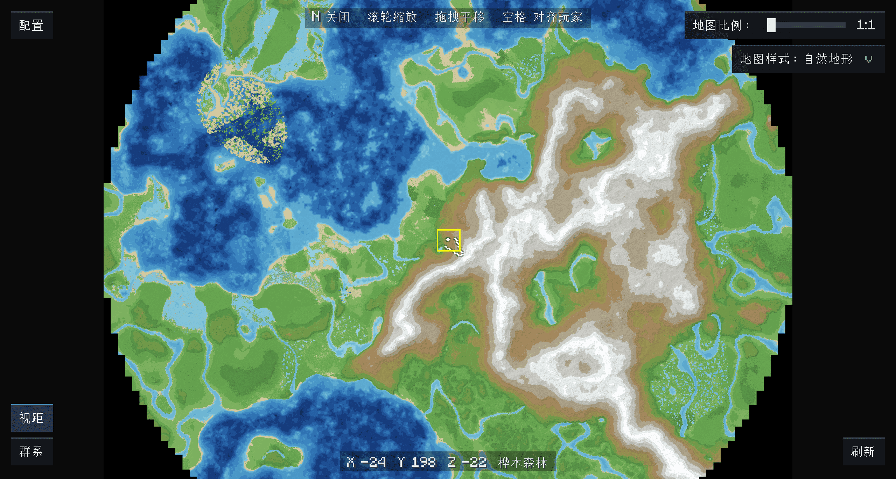

近景细节：等高线、山体阴影、水深着色、群系边界与标签：

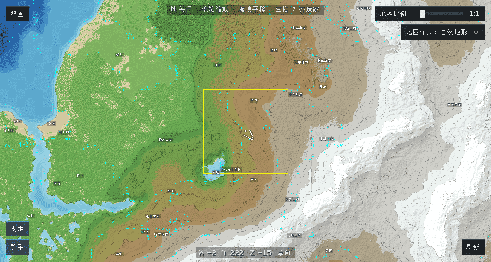

**原版地形**，Voxy SeedGen 距离 382 区块，黄色框为真实渲染距离：

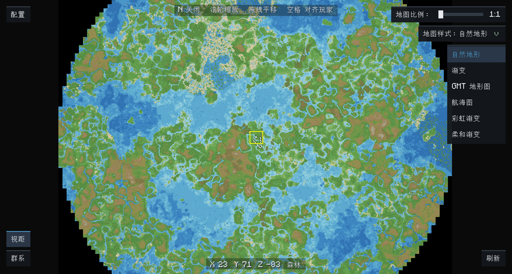

近景细节：等高线、山体阴影、水深着色、群系边界与标签：

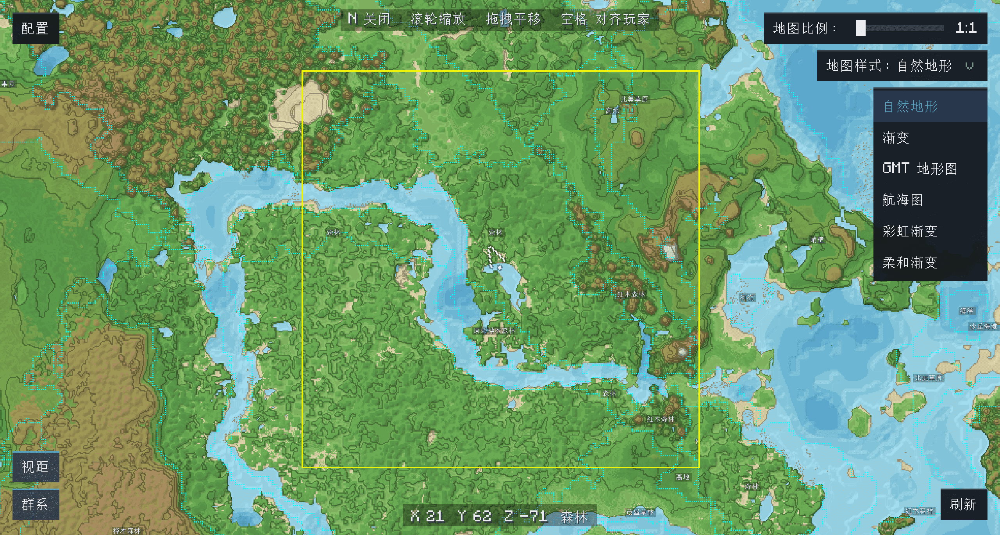

## 功能概览

**地图与交互**

- 按 **N** 打开/关闭全屏地图，**空格**对准玩家，滚轮缩放（插值平滑，以鼠标位置为锚点），拖拽平移
- 右上角：**地图比例滑块**（1:1 – 1:8，松开鼠标才重建）与「地图样式」下拉
- 视距框、鼠标坐标与群系显示，右键菜单（复制坐标 / 传送 / 导出 PNG）
- 左上「配置」，左下「视距」「群系」开关，右下「刷新」
- **每个世界独立记忆**地图比例、配色、叠加层开关与缩放
- 打开/关闭地图有平滑缩放动画（时间驱动，高帧率下也不会变快）

**渲染**

- 6 种配色：自然地形、渐变、GMT、航海、彩虹渐变、柔和渐变
- 等高线、山体阴影、水深着色、海洋模糊、补洞、可选去噪、自适应色带、陆地色带拉伸
- 群系边界（75% / 25% 不透明度交替的棋盘格虚线）+ 群系名标签（位置取区域**最大内切圆中心**，按面积过滤，被按钮/菜单/文字框压住时自动隐藏）
- 界面统一深色半透明风格：按钮 75%、浮层菜单 88%、对话框 90%、信息条 40%，悬停统一为平滑的强调色叠加动画

**3D 视图**（Fabric 26.2 / 26.1.2 / NeoForge 1.21.1）

- 样式选择器左侧的 **3D** 按钮：可轨道旋转的地形高度场视图（是地图的另一种渲染方式，不是单独渲染世界）
- GPU per-tile 地形：每个地图瓦片在后台线程生成一份不可变的顶点/索引缓冲，并占用 1024×1024 纹理图集中的一个 256×256 槽位；再由独立的渲染 pass 用 Minecraft 自己的方块管线绘制（在世界之上、GUI 之下）
- 三级网格精度：近景步长 1（≤512 格）、中景步长 4（≤2048 格）、远景步长 32（更远），距离按真实相机位置计算；先用远景铺满整张地图，再逐步细化，切换带 15% 滞回避免反复重建；瓦片边缘有默认 16 格向下的裙边遮住接缝
- 独立 `D32_FLOAT` 深度缓冲 + 反向 Z 深度测试，视锥剔除与背面剔除
- 图集显存由瓦片纹理预算限制（默认 256 MB ≈ 1024 个瓦片），优先淘汰最远的瓦片；调试面板（`Q`）把 `mesh` / `atlas` / `depth` 三项显存分开显示
- **故意全亮**：3D 地形复用 2D 地图的未打光配色，不随昼夜变暗
- 3D 群系标签（距离限制 + 地形遮挡）、悬浮在地形上方的玩家箭头、射线拾取的底部坐标与同样的右键菜单（拾取被裁剪到地图范围内，点天空或地图外不再出现假坐标）
- 2D↔3D 无缝切换（位置与比例对应）、退出时短暂旋转动画、可按世界记住 3D 相机
- **鼠标中键**：短按在 2D / 3D 之间切换，按住拖动则旋转 3D 相机（按按压时长与位移区分两种手势，拖动绝不会误切换视图）
- **空格**：在 2D 与 3D 中都会平滑地把视角移到玩家身上（0.22 秒缓动平移，与 3D 退出动画同时长、同缓动曲线；任何手动平移/旋转/缩放都会立即取消）
- `keep3dTilesIn2d` 在切回 2D 后保留已建好的 GPU 地形，下次进 3D 瞬间恢复（代价是显存）

**配置界面**

- 游戏内自绘配置界面：六个标签页（常规 / 地图绘制 / 地图数据 / 3D 视图 / 性能 / 调试）、每项带说明文字、分割线
- 开关、下拉、滑块（可拖动或点击输入数值）三种控件
- **草稿模式**：取消 = 丢弃、应用 = 保存不关闭、完成 = 保存并关闭、重置 = 恢复默认
- 打开/关闭淡入淡出、标签页切换时选项**依次淡入**、悬停动画
- NeoForge 侧同样使用自绘界面，配置写入 TOML；Fabric 写入 JSON

**数据与性能**

- 直接解码 Voxy 的 LOD 存储并合并所有层级，**不加载区块**
- 打开地图时**暂停世界渲染**（`skipWorldRender`），把帧率留给地图
- 瓦片随 Voxy 的区块事件实时更新；每个存档独立缓存目录 `voxymap-cache/<hash>/`（`tiles/*.vxt` + `source-index.bin` + `state.properties`；旧的 `map.vxm` / `color.vxc` 只属于已停用的全局路径）
- 重启后首次打开会读取 `color.vxc` **跳过重新渲染**，通常 1–2 秒出图
- 打开时先显示 1/4 分辨率小图，大图在后台构建；关闭只释放大图、保留小图，重开瞬间可见
- 群系掩码与标签也在后台生成，打开叠加层不再卡顿

## 兼容性

**语言** —— 界面提供 **English、简体中文、繁體中文、日本語、Русский、Deutsch、Français、Español、Português (BR)** 共 9 种，跟随游戏语言自动切换。所有文本都是翻译键，资源包可以覆盖或新增语言。群系名使用游戏自带的语言条目，模组群系同样适用。

**地形模组** —— 海平面从世界读取（`autoSeaLevel`），色带按世界实际高度范围拉伸（`adaptiveColorRamp`、`landMaxRamp`），所以自定义地形也能有正确的海岸线和配色层次，不会被原版固定高度压扁。截图里使用的就是 Tectonic 模组生成的地形。

**群系模组** —— 群系名称与边界来自 Voxy 为该世界存下的群系数据；模组群系会按客户端群系注册表反查，名称能正常显示，模组自带语言文件时也会翻译。

## 前置要求

**Fabric（26.2 / 26.1.2）**

| 依赖 | 版本 | 必需性 | 说明 |
| --- | --- | --- | --- |
| Minecraft | 26.2 或 26.1.2 | 必需 | 与下载的 jar 版本一致 |
| Fabric Loader | 0.19.5+ | 必需 | 加载器 |
| Fabric API | 对应版本（26.2：0.161.0+26.2；26.1.2：0.155.3+26.1.2） | 必需 | 提供按键、生命周期等 API |
| [Voxy](https://modrinth.com/mod/voxy) | 对应 Fabric 版本 | 必需 | 提供地图数据：本模组直接读取它的 LOD 存储 |
| [Mod Menu](https://modrinth.com/mod/modmenu) | 对应版本 | 可选 | 不装也能玩，装了会在模组列表里多一个「配置」入口 |
| [Voxy SeedGen](https://modrinth.com/mod/voxy-seedgen) | 0.3+ | 推荐（可选） | 按世界种子预生成远景；不装时地图只覆盖你实际探索过的区域 |

**NeoForge（1.21.1）**

| 依赖 | 版本 | 必需性 | 说明 |
| --- | --- | --- | --- |
| Minecraft | 1.21.1 | 必需 | 游戏本体 |
| NeoForge | 21.1.224+ | 必需 | 模组加载器 |
| [Voxy](https://modrinth.com/mod/voxy) | 0.2+ | 必需 | 提供地图数据 |
| [Roxy](https://modrinth.com/mod/roxy) | 0.4+ | 必需（使用第三方 Voxy 移植时不必须） | 把 Fabric 版 Voxy 接到 NeoForge 的桥接层 |
| Sodium | 0.6.13+ | 必需 | Voxy 的渲染依赖（由 Roxy 声明） |
| [Voxy SeedGen](https://modrinth.com/mod/voxy-seedgen) | 0.3+ | 推荐（可选） | 远景预生成 |

> 本模组为纯客户端模组，不需要安装在服务端。

已验证环境：Fabric 26.2 / Loader 0.19.5 / Voxy 0.2.19-beta、Fabric 26.1.2 / Loader 0.20.1 / Voxy 0.2.18-beta、NeoForge 21.1.265 / Voxy 0.2.16-beta（经 Roxy 0.4.1）；三个环境都装了 Voxy SeedGen 0.3.1。

## 安装

1. 按平台安装 Minecraft 与加载器（Fabric 26.2 / 26.1.2，或 NeoForge 1.21.1）
2. 安装上表里的前置模组（Fabric 必装 Fabric API 与 Voxy；NeoForge 必装 Voxy、Roxy、Sodium）
3. 从 [Releases](https://github.com/Tsutsutsuu/voxy-map/releases) 下载对应 jar，放进实例的 `mods` 目录：
   - `voxy-map-x.y.z+26.2+fabric.jar`（Fabric 26.2）
   - `voxy-map-x.y.z+26.1.2+fabric.jar`（Fabric 26.1.2）
   - `voxy-map-x.y.z+1.21.1+neoforge.jar`（NeoForge 1.21.1）
4. 启动游戏，按 **N** 打开地图

首次打开需要读取 Voxy 存储并渲染，视探索范围约 **10–20 秒**（渲染结果会写入 `color.vxc`）；之后再启动游戏重开只需读取缓存，通常 **1–2 秒**。同一个游戏进程内反复开关地图则是瞬时的。

## 使用

| 操作 | 默认按键 |
| --- | --- |
| 打开 / 关闭地图 | `N` |
| 对准玩家位置 | `空格` |
| 缩放 | 鼠标滚轮 |
| 平移 | 按住鼠标左键拖拽 |
| 地图菜单 | 鼠标右键（复制坐标 / 传送 / 导出 PNG） |
| 调试面板 | `Q`（配置 `debugEnabled`，默认开启） |
| 关闭地图 | `Esc` |

两个按键都可改：**选项 → 控制 → 按键绑定 → Voxy Map**。

右上角「地图比例」滑块：拖动只改变显示，**松开鼠标**才按新比例重建，重建期间滑块锁定。

右键菜单里的「传送」需要 OP 权限（可在配置里关闭），「导出 PNG」把当前地图保存到实例的 `voxymap-exports/` 目录。

**配置界面**里：`Esc`、`取消`、`完成` 都会回到地图（不会退出地图）；`重置` 恢复默认值但不保存；只有 `应用` / `完成` 才会写入配置。

## 配置

所有选项都能在游戏内自绘配置界面里修改（Fabric 在 Mod Menu 的「配置」或地图左上角「配置」；NeoForge 在模组列表的「配置」或地图左上角），也可以直接编辑配置文件：

- Fabric：`config/voxymap-client.json`
- NeoForge：`config/voxymap-client.toml`

游戏内配置界面分六个标签页（常规 / 地图绘制 / 地图数据 / 3D 视图 / 性能 / 调试）。NeoForge 的 TOML 把配置分成 `ui` / `map` / `data` / `view3d` / `perf` / `debug` 六组（另有一个对界面隐藏的 `legacy` 组存旧键）；Fabric 的 JSON 是平铺的键列表。常用项：

| 配置项 | 分组 | 默认 | 说明 |
| --- | --- | --- | --- |
| `liveTiles` | data | `true` | 把 Voxy 的区块更新实时流入 2D 瓦片（已经不存在全局自动刷新） |
| `mapScale` | data | 2 | 地图比例 1–8（1:1 最精细也最慢，1:8 最粗最快） |
| `maxLodLevel` | data | 4 | 合并的最高 Voxy LOD 层级（0–4） |
| `cacheKeepCount` / `diskCacheMaxMb` | data | 5 / 8192 | 保留多少个存档缓存目录（1–100）/ 单个存档的磁盘缓存上限（MB）|
| `autoSeaLevel` / `seaLevelOverride` | data | `true` / 63 | 从世界读取海平面 / 手动海平面 |
| `defaultStyle` | rendering | `current` | 新世界的默认配色 |
| `defaultZoom` / `rememberZoom` | rendering | 0.5 / `true` | 默认地图缩放 / 是否在关闭时记住当前缩放 |
| `drawContours` / `contourDensity` / `minContourArea` | rendering | `true` / 12 / 40 | 等高线开关、密度与最小碎片面积 |
| `drawHillshade` / `drawWaterDepth` | rendering | `true` / `true` | 山体阴影 / 水深着色 |
| `adaptiveColorRamp` / `landMaxRamp` | rendering | `true` / `true` | 色带自适应 / 陆地色带按地图最高点拉伸 |
| `waterBlur` / `waterBlurRadius` / `waterBlurPasses` | rendering | `true` / 8 / 2 | 海洋模糊 |
| `denoise` / `fillHoles` | rendering | `false` / `false` | 去噪 / 补洞 |
| `showBiomes` / `biomeLabelMinArea` / `biomeLabelBackground` | rendering | `false` / 600 / `true` | 群系叠加、标签最小面积、标签背景 |
| `arrowStyle` / `showRenderDistance` | rendering | `clean` / `false` | 箭头样式 / 视距框 |
| `releaseTexturesOnClose` / `skipWorldRender` | rendering | `true` / `true` | 关闭释放大图纹理 / 打开地图时跳过世界渲染 |
| `showCoordinates` / `showHint` / `teleportEnabled` / `debugEnabled` | ui | `true` / `true` / `true` / `true` | 坐标、操作提示、传送菜单、调试面板 |

3D 视图配置（三个构建都有）：

| 配置项 | 默认 | 说明 |
| --- | --- | --- |
| `gpuTerrainNearDistance` / `gpuTerrainMidDistance` | 512 / 2048 | 使用最高 / 中等网格精度的距离（格，按相机位置计算） |
| `gpuTerrainNearStep` / `gpuTerrainMidStep` / `gpuTerrainFarStep` | 1 / 4 / 32 | 近 / 中 / 远景每个顶点覆盖的地图像素（必须整除 256） |
| `gpuTerrainSkirtDepth` | 16 | 瓦片边缘向下的裙边深度，用来遮住精度接缝 |
| `gpuTerrainHysteresisPct` | 15 | 精度切换的滞回百分比（避免反复重建） |
| `gpu3dBuildThreads` / `gpu3dBatchBuild` | 0 / 10 | 后台网格构建线程数（0 = 自动，最多 6）/ 每帧提交的瓦片构建数 |
| `keep3dTilesIn2d` | `true` | 切回 2D 后保留已建好的 GPU 地形，下次进 3D 更快（代价是显存） |
| `gpuTextureBudgetMb` | 256 | 瓦片纹理显存预算，同时限制 3D 图集（每 MB 4 个瓦片，默认 1024 个） |
| `fov3d` / `verticalScale3d` / `minDistance3d` / `maxDistance3d` | 55 / 1.0 / 64 / 8192 | 3D 相机 |
| `autoHideContours3d` / `biomeLabel3dRange` | `false` / 3000 | 3D 下隐藏 2D 等高线 / 群系标签水平范围（格） |

> 配置里的默认值只对**新世界**生效；每个世界的样式、叠加层开关、地图比例与缩放另外保存在 `voxymap-cache/<hash>/state.properties`，进存档时自动恢复。

## 常见问题

**地图打不开 / 只显示一部分？**
先确认前置模组已装好（Fabric 需要 Voxy；NeoForge 需要 Voxy + Roxy）。没有 SeedGen 时，地图只覆盖 Voxy 已存下的数据，边缘未探索的区域是黑色的——这是「没有数据」，不是渲染错误。

**在下界 / 末地打开地图只看到一行提示？**
目前只绘制主世界：下界/末地不建图、不刷新，打开地图会显示「目前只支持绘制主世界 LOD 地图」。

**数据更新了但地图还是旧的？**
磁盘缓存不会自动失效，点右下角「**刷新**」强制重建即可。

**重启游戏后第一次开图要等几秒？**
首次会从 `map.vxm`（网格）和 `color.vxc`（渲染结果）重建纹理；如果改了配色、比例或渲染选项，缓存失效，会重新渲染一次（约 5–8 秒），之后再次启动就快了。

**关闭地图后显存还会占用？**
`releaseTexturesOnClose`（默认开启）在关闭地图时只释放大图纹理、保留 1/4 小图（约 5 MB），这样重开时能立刻显示画面、大图在后台重建。想要彻底清空可以把这一项关掉后再开一次地图，或直接重启游戏。

**样式 / 比例 / 叠加层 / 缩放换存档后没保留？**
这些设置按世界保存：同一个存档内会记住，新世界使用配置里的默认值（`defaultStyle`、`defaultZoom` 等）。

**帧率偏低？**
确认 `skipWorldRender = true`（默认开启）；另外关闭群系叠加、调粗地图比例都能减轻负担。

## 已知限制

- 目前只支持主世界（下界/末地不绘制）
- 群系按注册名 path 反查，多个模组存在同名群系时可能显示错误（概率低）
- GPU 3D 视图在三个构建里都有。NeoForge 1.21.1 版通过一层小的 Blaze3D 兼容层跑在 1.21.1 的 GL 管线上：复用主目标的 24bit 深度缓冲 + 标准 Z（Fabric 两版是私有 D32 纹理 + 反向 Z），背面剔除与 Fabric 版一致（瓦片绕序已实机验证）；行为、LOD、atlas 预算、裙边、标签、拾取、距离带都与 Fabric 一致
- Fabric 26.1.2 在开启 `skipWorldRender` 时关闭地图有**偶发** NV 驱动崩溃（`nvoglv64.dll`，暂未复现定位）；26.2 无此问题。详见本地文档 `doc/踩坑记录.md` §22.1

## 从源码构建

Fabric 版本用 Stonecutter 单工程（26.2 / 26.1.2 共用源码），需要 **JDK 25**：

```bash
cd stonecutter
./gradlew build
```

Windows 用 `.\gradlew.bat build`。产物：

```
stonecutter/versions/26.2-fabric/build/libs/voxy-map-0.2.0+26.2+fabric.jar
stonecutter/versions/26.1-fabric/build/libs/voxy-map-0.2.0+26.1.2+fabric.jar
```

> 两个 Fabric 节点都能构建：`.\gradlew.bat :26.2-fabric:build` 与 `:26.1-fabric:build`。26.2 独有的 Blaze3D 差异集中在 `com/voxymap/BlazeCompat.java`（Stonecutter 条件注释）；新增 26.2-only API 时扩展这个版本屏障，不要在业务代码里散落条件分支。

NeoForge 版本需要 **JDK 21**：

```bash
cd mod
./gradlew build
```

产物：`mod/build/libs/voxy-map-0.2.0+1.21.1+neoforge.jar`。

<details>
<summary>仓库结构与离线 POC 工具（开发者）</summary>

```
voxy-map/
├── stonecutter/          Fabric 多版本工程（Stonecutter）
│   ├── src/main/java/com/voxymap/   共享源码（26.2 为主，26.1 由 replacements 适配）
│   ├── src/main/resources/          资源（lang ×9、纹理、图标、voxymap.mixins.json）
│   ├── settings.gradle.kts / stonecutter.gradle.kts / stonecutter.properties.toml
│   └── versions/<node>/build/libs/  每版本产物
├── mod/                  NeoForge 1.21.1 工程
│   ├── src/main/java/com/voxymap/   模组源码（含 mixin/）
│   ├── src/main/resources/          资源（lang、纹理、图标、voxymap.mixins.json）
│   └── build.gradle / gradle.properties / settings.gradle
├── poc/                  离线验证工具（Java 单文件，POC 与数据诊断）
└── img/                  README 截图（raw/ 为本地原图，不入库）
```

`poc/` 里的工具可以直接读取实例的 Voxy storage 离线渲染/诊断地图，编译运行需要 rocksdbjni 10.2.1 与 zstd-jni 1.5.6-3：

```powershell
java -Xmx8G -cp "<rocksdbjni>;<zstd-jni>;out" VoxyMapPoC10 "<storage目录>" out.png 2 63 4 current
```

</details>

## 许可证

本项目采用 **MIT** 许可证，详见 [LICENSE](LICENSE)。

图标与截图 © Tsutsutsuu；地图数据来自 Voxy 与其 SeedGen 插件。
