# Voxy Map

<p align="left">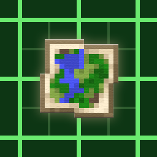</p>

**[English](#voxy-map)** | [简体中文](#简体中文)

***What you see is what you get*** — the map reaches exactly as far as the world renders: it reads Voxy's level-of-detail data directly, loads no chunks, flies nowhere, and turns the explored world into a full-screen terrain map (a first build takes around 10–20 seconds depending on the explored area; reopening uses the cache and is instant).

A Minecraft world map mod (mod id `voxymap`). Currently supports **Minecraft 1.21.1 NeoForge**, client-side only; other versions, loaders and dimensions are planned.

Best used together with **Voxy SeedGen** — it pre-generates distant terrain from the world seed so the map actually covers the world:

- Voxy SeedGen: <https://modrinth.com/mod/voxy-seedgen>

---

## Screenshots

### Six palettes

**Tectonic mod** with the "i use voxy btw" preset; Voxy SeedGen distance 382 chunks, yellow box = actual render distance (natural / gradient / GMT / nautical / gradient-turbo / gradient-soft):

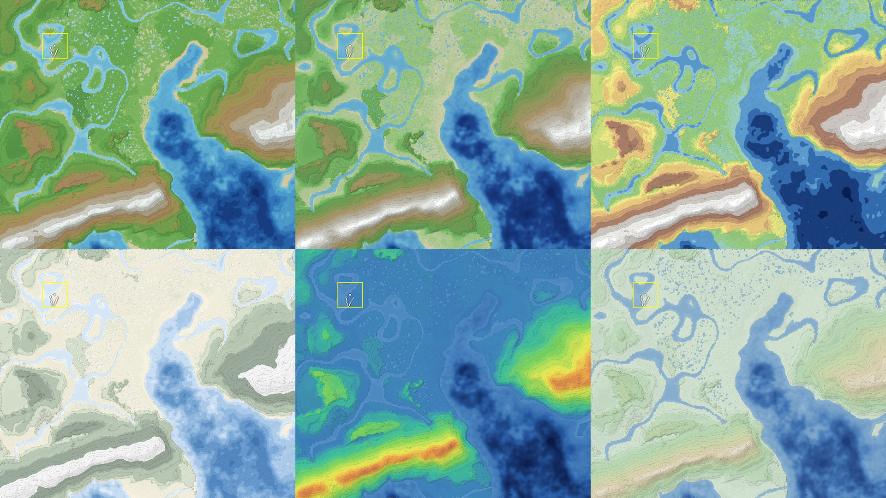

**Vanilla terrain**, same set of palettes, with biome boundaries and biome labels:

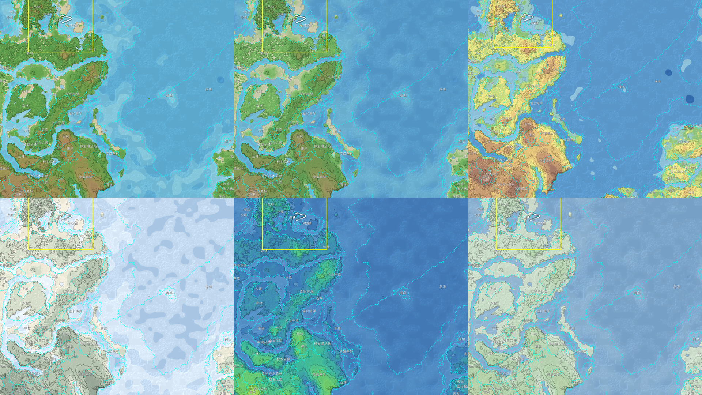

### Fullscreen map

**Tectonic mod** with the "i use voxy btw" preset; Voxy SeedGen distance 382 chunks, yellow box = actual render distance:

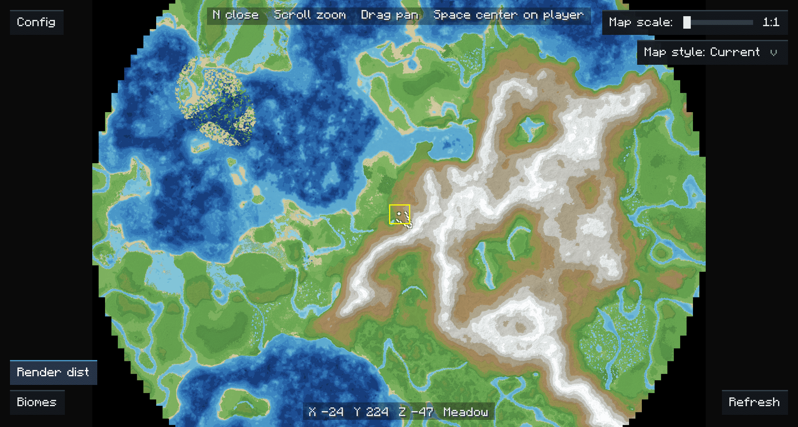

Close-up: contour lines, hillshade, water-depth shading, biome boundaries and labels:

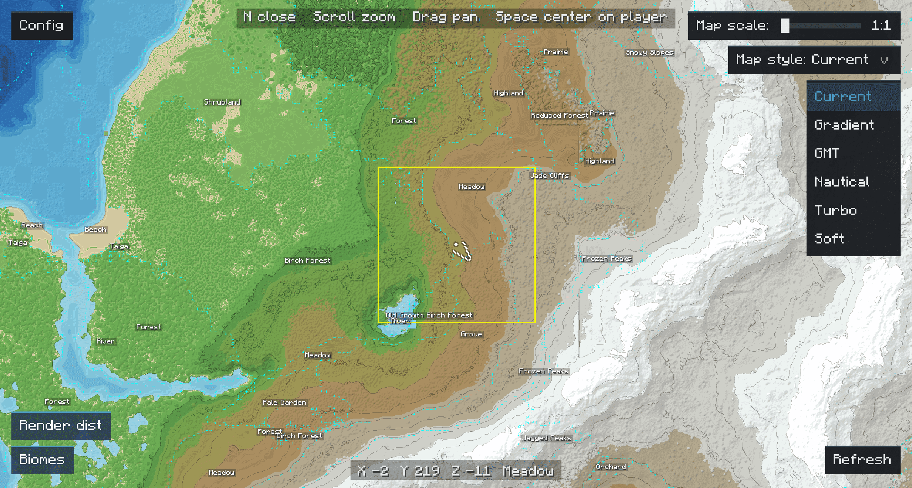

**Vanilla terrain**, Voxy SeedGen distance 382 chunks, yellow box = actual render distance:

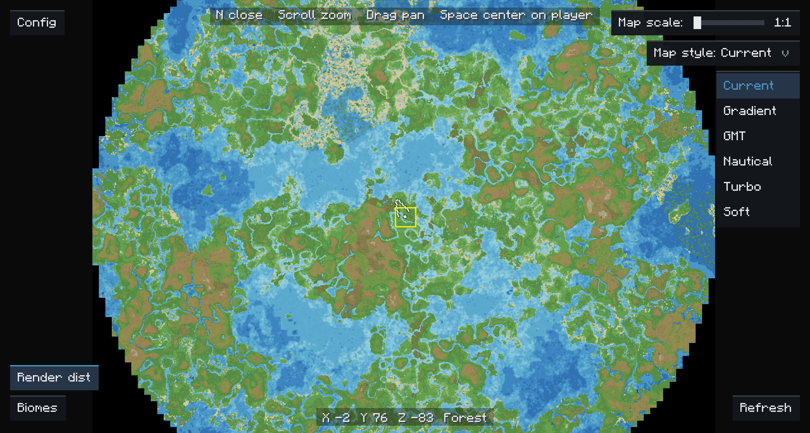

Close-up: contour lines, hillshade, water-depth shading, biome boundaries and labels:

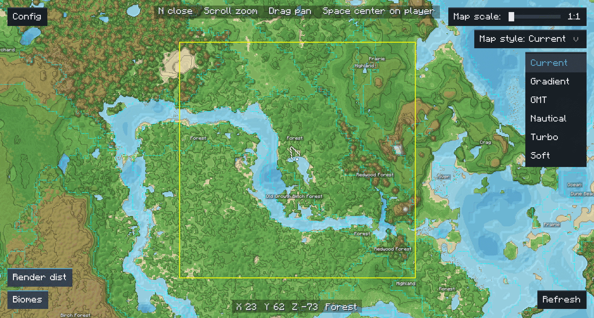

## Features

**Map and interaction**

- **N** opens/closes the fullscreen map, **Space** re-centres on the player, scroll to zoom, drag to pan
- Top-right: a **map scale slider** (1:1 – 1:8, rebuilds on release) and the "Map style" dropdown
- Render-distance box, cursor coordinates and biome name, right-click menu (copy coordinates / teleport / export PNG)
- "Config" (top-left), "Render distance" / "Biomes" toggles (bottom-left), "Refresh" (bottom-right)
- **Every world remembers** its own map scale, palette and overlay toggles

**Rendering**

- Six palettes: natural, gradient, GMT, nautical, gradient-turbo, gradient-soft
- Contour lines, hillshade, water-depth shading, ocean blur, hole filling, optional denoise, adaptive colour ramp
- Biome boundaries (dashed checkerboard) and biome labels (filtered by area; hidden when a button, menu or text plate would cover them)

**Data and performance**

- Decodes Voxy's LOD storage and merges every level — **no chunk loading**
- **Pauses world rendering** while the map is open (`skipWorldRender`), so the frame budget goes to the map
- Automatic refresh when the player moves far; one disk cache per world (`voxymap-cache/`), reopening is instant, at most 5 caches are kept
- Releases its textures when the map is closed

**Almost everything is configurable** — in game under "Mods → Voxy Map → Config", or in `config/voxymap-client.toml`.

## Compatibility

**Languages** — the interface ships in **English** and **简体中文** and follows the game language. Every label is a translation key, so a resource pack can override or add languages; the config screen comments stay bilingual (NeoForge does not translate comments). Biome names come from the game's own language entries, including modded biomes.

**Terrain mods** — the sea level is read from the world (`autoSeaLevel`) and the colour ramp stretches to the world's actual height range (`adaptiveColorRamp`, `landMaxRamp`), so custom terrain generators keep a correct coastline and colour spread instead of being flattened by fixed vanilla heights. The terrain in the screenshots is generated by the Tectonic mod.

**Biome mods** — biome names and boundaries are read from the biome data Voxy stored for the world. Modded biomes are resolved through the client biome registry, so their names show up and are translated when the mod ships a language file.

## Requirements

| Dependency | Version | Necessity | Notes |
| --- | --- | --- | --- |
| Minecraft | 1.21.1 | Required | The game itself |
| NeoForge | 21.1.224+ | Required | Mod loader; Roxy requires 21.1.224+, this project targets 21.1.217 |
| [Voxy](https://modrinth.com/mod/voxy) | 0.2+ | Required | Source of the map data: this mod reads its LOD storage |
| [Roxy](https://modrinth.com/mod/roxy) | 0.4+ | Required (not needed when a third-party Voxy port is used) | Bridges the Fabric Voxy onto NeoForge; Voxy does not run without it |
| Sodium | 0.6.13+ | Required | Rendering dependency of Voxy (declared by Roxy) |
| [Voxy SeedGen](https://modrinth.com/mod/voxy-seedgen) | 0.3+ | Recommended (optional) | Pre-generates distant terrain from the seed; without it the map only covers areas you actually explored |

> This is a client-side mod. It relies on Voxy through the Roxy bridge; other third-party Voxy ports are untested.

Tested with: Minecraft 1.21.1 / NeoForge 21.1.265, Voxy 0.2.16-beta (via Roxy 0.4.1), Voxy SeedGen 0.3.1.

## Installation

1. Install Minecraft 1.21.1 and NeoForge 21.1.224+
2. Install the prerequisites: Voxy, Roxy, Sodium (plus SeedGen, recommended)
3. Download `voxy-map-x.y.z.jar` from [Releases](https://github.com/Tsutsutsuu/voxy-map/releases) and drop it into the instance's `mods` folder
4. Launch the game and press **N**

The first open reads Voxy's storage and renders — around 10–20 seconds depending on the explored area; after that it reuses the disk cache and opens instantly.

## Controls

| Action | Default key |
| --- | --- |
| Open / close map | `N` |
| Re-centre on the player | `Space` |
| Zoom | Mouse wheel |
| Pan | Hold the left mouse button and drag |
| Map menu | Right mouse button (copy coordinates / teleport / export PNG) |
| Debug panel | `Q` (`debugEnabled`, on by default) |
| Close map | `Esc` |

Both key bindings can be changed in **Options → Controls → Key Binds → Voxy Map**.

The "Map scale" slider in the top-right only changes the readout while dragging; the map rebuilds at the new scale **when the mouse is released**, and the slider stays locked while the build runs.

"Teleport" in the right-click menu requires OP permission (can be disabled in the config); "Export PNG" saves the current map to `voxymap-exports/` in the instance folder.

## Configuration

Every option has a bilingual comment, grouped into `refresh` / `data` / `rendering` / `ui`; edit them in the in-game config screen or directly in `config/voxymap-client.toml`. Common options:

| Option | Group | Default | Description |
| --- | --- | --- | --- |
| `mapScale` | data | 2 | Map scale 1–8 (1:1 sharpest and slowest, 1:8 coarsest and fastest) |
| `maxLodLevel` | data | 4 | Highest Voxy LOD level to merge (0–4) |
| `cacheKeepCount` | data | 5 | How many world caches to keep (1–100) |
| `autoSeaLevel` / `seaLevelOverride` | data | `true` / 63 | Read the sea level from the world / manual sea level |
| `defaultStyle` | rendering | `current` | Default palette for new worlds |
| `defaultZoom` | rendering | 0.5 | Initial zoom when opening the map |
| `autoRefresh` / `refreshDistanceChunks` | refresh | `true` / 128 | Refresh once the player moved this many chunks |
| `initialRefreshDelayMinutes` | refresh | 3 | Refresh this many minutes after joining (gives SeedGen time) |
| `drawContours` / `contourDensity` | rendering | `true` / 12 | Contours on/off and their density |
| `drawHillshade` / `drawWaterDepth` | rendering | `true` / `true` | Hillshade / water-depth shading |
| `waterBlur` / `waterBlurRadius` | rendering | `true` / 8 | Ocean blur |
| `fillHoles` / `denoise` | rendering | `true` / `false` | Hole filling / denoise |
| `showBiomes` / `biomeLabelMinArea` | rendering | `false` / 600 | Biome overlay / minimum label area (pixels) |
| `biomeLabelBackground` | rendering | `true` | Biome label background (75% transparent) |
| `skipWorldRender` | rendering | `true` | Skip world rendering while the map is open (disable on conflicts) |
| `releaseTexturesOnClose` | rendering | `true` | Release textures when the map is closed |
| `debugEnabled` | ui | `true` | Debug panel on `Q` in the map screen |

> The config holds the values for **new worlds**. Each world's palette, overlay toggles and map scale are stored separately in `voxymap-cache/<hash>.state` and restored when that world is opened.

## FAQ

**The map is empty or only partially filled?**
Make sure Voxy and Roxy are installed. Without SeedGen the map only covers the data Voxy has already stored, so unexplored edges stay empty — that is expected.

**Opening the map in the Nether / End only shows a single line?**
Only the overworld is drawn for now: the Nether and the End neither build nor refresh, the screen just shows "Only overworld LOD maps are supported for now".

**The data changed but the map is still old?**
The disk cache does not invalidate automatically. Click "**Refresh**" in the bottom-right corner to rebuild it.

**Biomes differ from what F3 shows?**
With `mapScale = 2` one pixel represents 2×2 blocks, so borders may take the neighbouring column. Set the scale to 1:1 and refresh for a sharper map.

**Memory / VRAM usage seems high?**
Texture size grows with the explored area. Closing the map releases textures by default (`releaseTexturesOnClose`).

**My style / scale / overlays were not kept after switching worlds?**
Those settings are per world: the same save remembers them, a new world starts from the config defaults.

**Frame rate feels low?**
Make sure `skipWorldRender = true` (the default) — it skips the world render pass while the map is open. Turning off the biome overlay or using a coarser map scale also helps.

## Known limitations

- Only the overworld is supported (nothing is drawn in the Nether or the End)
- Biomes are resolved by registry path, so mods with identically named biomes may show the wrong one (unlikely)

## Building from source

Requires JDK 21:

```bash
cd mod
./gradlew build
```

On Windows use `.\gradlew.bat build`. Output: `mod/build/libs/voxy-map-0.1.0+1.21.1.jar`.

> Behind a restrictive network Gradle needs a proxy; see `systemProp.https.proxyHost` / `proxyPort` in `mod/gradle.properties`.

<details>
<summary>Repository layout and offline POC tools (developers)</summary>

```
voxy-map/
├── mod/                  Gradle project (sources + build scripts)
│   ├── src/main/java/com/voxymap/   mod sources (incl. mixin/)
│   ├── src/main/resources/          resources (lang, textures, icon, voxymap.mixins.json)
│   ├── build.gradle / gradle.properties / settings.gradle
│   ├── gradle/ gradlew gradlew.bat  build wrapper
│   └── libs/            rocksdbjni compile-only dependency (not bundled)
├── poc/                  offline tools (single-file Java, POC and data diagnostics)
└── img/                 README screenshots (raw/ holds local originals, not committed)
```

The tools in `poc/` read an instance's Voxy storage offline to render/diagnose the map. They need rocksdbjni 10.2.1 and zstd-jni 1.5.6-3:

```powershell
java -Xmx8G -cp "<rocksdbjni>;<zstd-jni>;out" VoxyMapPoC10 "<storage dir>" out.png 2 63 4 current
```

</details>

## License

MIT — see [LICENSE](LICENSE).

Icon and screenshots © Tsutsutsu; map data comes from Voxy and its SeedGen add-on.

---

# 简体中文

[English](#voxy-map) | **[简体中文](#简体中文)**

*****所见即所得*** —— 能看多远，地图就画多远：直接读取 Voxy 的 LOD 数据，不加载区块、不跑图，把探索过的世界变成一张全屏地形图（首次生成视范围约 10–20 秒，之后走缓存秒开）。**

一个 Minecraft 世界地图模组（mod id `voxymap`）。目前支持 **Minecraft 1.21.1 NeoForge**，纯客户端；其他版本/加载器与维度支持计划中。

配合 **Voxy SeedGen** 使用效果最佳 —— 它按世界种子预生成远景数据，地图才完整：

- Voxy SeedGen：<https://modrinth.com/mod/voxy-seedgen>

---

## 截图

### 6 种配色

使用 **Tectonic Mod** 的 "i use voxy btw" 预设地形，Voxy SeedGen 距离 382 区块，黄色框为真实渲染距离（自然地形 / 渐变 / GMT / 航海 / 彩虹渐变 / 柔和渐变）：


**原版地形**，同一组配色，带群系边界与群系名标签：


### 全屏地图

使用 **Tectonic Mod** 的 "i use voxy btw" 预设地形，Voxy SeedGen 距离 382 区块，黄色框为真实渲染距离：

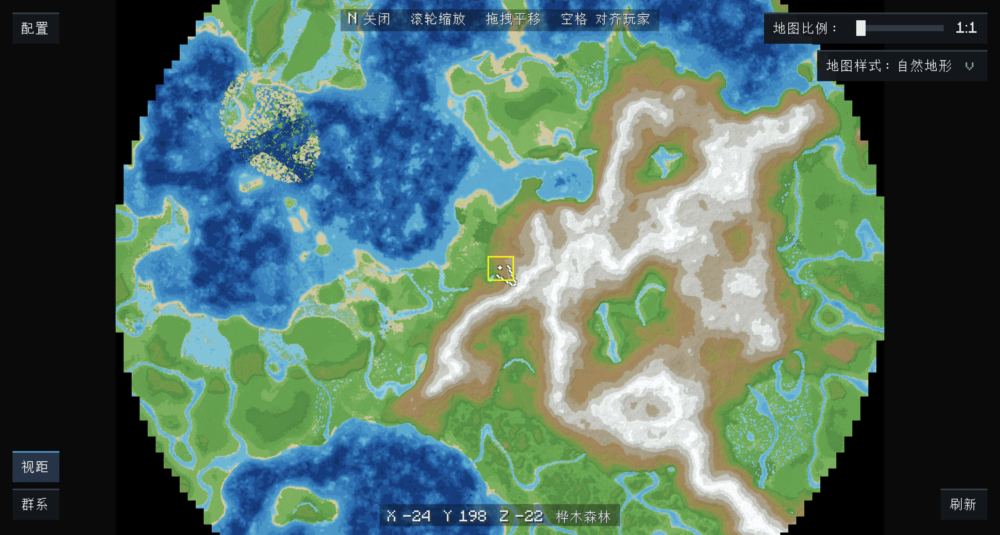

近景细节：等高线、山体阴影、水深着色、群系边界与标签：

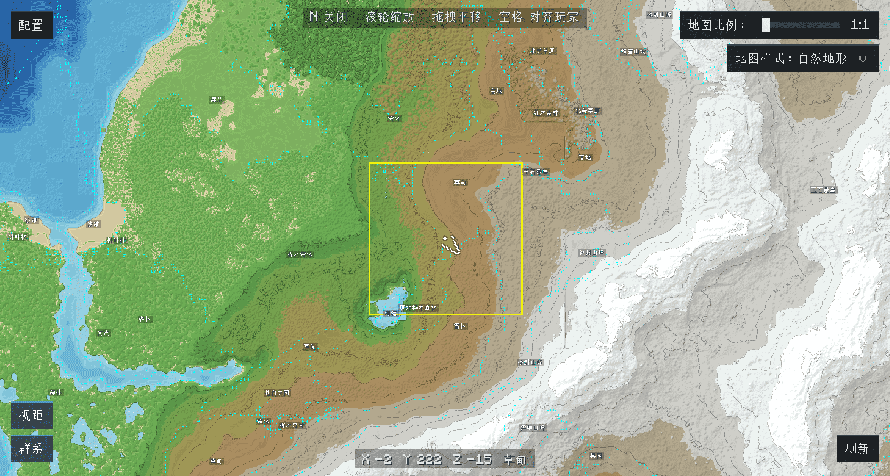

**原版地形**，Voxy SeedGen 距离 382 区块，黄色框为真实渲染距离：

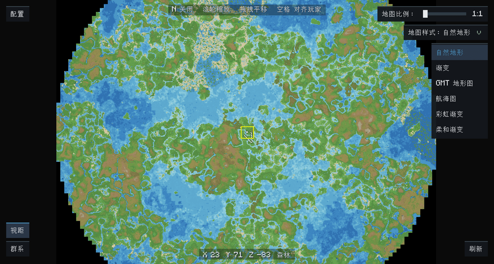

近景细节：等高线、山体阴影、水深着色、群系边界与标签：

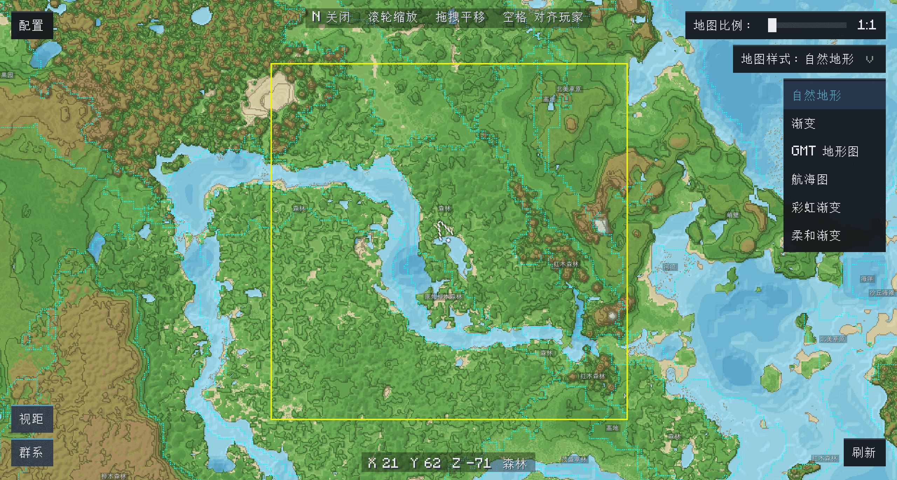


## 功能概览

**地图与交互**

- 按 **N** 打开/关闭全屏地图，**空格**对准玩家，滚轮缩放，拖拽平移
- 右上角：**地图比例滑块**（1:1 – 1:8，松开鼠标才重建）与「地图样式」下拉
- 视距框、鼠标坐标与群系显示，右键菜单（复制坐标 / 传送 / 导出 PNG）
- 左上「配置」，左下「视距」「群系」开关，右下「刷新」
- **每个世界独立记忆**地图比例、配色与叠加层开关

**渲染**

- 6 种配色：自然地形、渐变、GMT、航海、彩虹渐变、柔和渐变
- 等高线、山体阴影、水深着色、海洋模糊、补洞、可选去噪、自适应色带
- 群系边界（棋盘格虚线）+ 群系名标签（按面积过滤；被按钮、菜单或文字框压住时自动隐藏）

**数据与性能**

- 直接解码 Voxy 的 LOD 存储并合并所有层级，**不加载区块**
- 打开地图时**暂停世界渲染**（`skipWorldRender`），把帧率留给地图
- 玩家移动较远时自动刷新；每个存档一份磁盘缓存（`voxymap-cache/`），重开秒进，最多保留 5 份
- 关闭地图自动释放纹理

**几乎都能配置** —— 游戏内「模组 → Voxy Map → 配置」，或 `config/voxymap-client.toml`。

## 兼容性

**语言** —— 界面提供 **English** 与 **简体中文**，跟随游戏语言切换。所有文本都是翻译键，资源包可以覆盖或新增语言；配置界面的注释固定中英双语（NeoForge 不翻译注释）。群系名使用游戏自带的语言条目，模组群系同样适用。

**地形模组** —— 海平面从世界读取（`autoSeaLevel`），色带按世界实际高度范围拉伸（`adaptiveColorRamp`、`landMaxRamp`），所以自定义地形也能有正确的海岸线和配色层次，不会被原版固定高度压扁。截图里使用的就是 Tectonic 模组生成的地形。

**群系模组** —— 群系名称与边界来自 Voxy 为该世界存下的群系数据；模组群系会按客户端群系注册表反查，名称能正常显示，模组自带语言文件时也会翻译。

## 前置要求

| 依赖 | 版本 | 必需性 | 说明 |
| --- | --- | --- | --- |
| Minecraft | 1.21.1 | 必需 | 游戏本体 |
| NeoForge | 21.1.224+ | 必需 | 模组加载器；Roxy 要求 21.1.224+，本项目编译目标为 21.1.217 |
| [Voxy](https://modrinth.com/mod/voxy) | 0.2+ | 必需 | 提供地图数据：本模组直接读取它的 LOD 存储 |
| [Roxy](https://modrinth.com/mod/roxy) | 0.4+ | 必需/使用第三方移植Voxy时不必须 | 把 Fabric 版 Voxy 加载到 NeoForge 的桥接层，没有它 Voxy 无法运行 |
| Sodium | 0.6.13+ | 必需 | Voxy 的渲染依赖（由 Roxy 的依赖声明要求） |
| [Voxy SeedGen](https://modrinth.com/mod/voxy-seedgen) | 0.3+ | 推荐（可选） | 按世界种子预生成远景；不装时地图只覆盖你实际探索过的区域 |

> 本模组为纯客户端模组。依赖的是使用 Roxy 翻译层的 Voxy，其他第三方 Voxy 移植版本未测试。

已验证环境：Minecraft 1.21.1 / NeoForge 21.1.265、Voxy 0.2.16-beta（经 Roxy 0.4.1 桥接）、Voxy SeedGen 0.3.1。

## 安装

1. 安装 Minecraft 1.21.1 与 NeoForge 21.1.224+
2. 安装前置：Voxy、Roxy、Sodium（推荐再加 SeedGen）
3. 从 [Releases](https://github.com/Tsutsutsuu/voxy-map/releases) 下载 `voxy-map-x.y.z.jar`，放进实例的 `mods` 目录
4. 启动游戏，按 **N** 打开地图

首次打开需要读取 Voxy 存储并渲染，视探索范围约 **10–20 秒**；之后复用磁盘缓存，秒开。

## 使用

| 操作 | 默认按键 |
| --- | --- |
| 打开 / 关闭地图 | `N` |
| 对准玩家位置 | `空格` |
| 缩放 | 鼠标滚轮 |
| 平移 | 按住鼠标左键拖拽 |
| 地图菜单 | 鼠标右键（复制坐标 / 传送 / 导出 PNG） |
| 调试面板 | `Q`（配置 `debugEnabled`，默认开启） |
| 关闭地图 | `Esc` |

两个按键都可改：**选项 → 控制 → 按键绑定 → Voxy Map**。

右上角「地图比例」滑块：拖动只改变显示，**松开鼠标**才按新比例重建，重建期间滑块锁定。

右键菜单里的「传送」需要 OP 权限（可在配置里关闭），「导出 PNG」把当前地图保存到实例的 `voxymap-exports/` 目录。

## 配置

所有选项都带中英双语注释，分 `refresh` / `data` / `rendering` / `ui` 四组，可在游戏内配置界面修改，或直接编辑实例的 `config/voxymap-client.toml`。常用项：

| 配置项 | 分组 | 默认 | 说明 |
| --- | --- | --- | --- |
| `mapScale` | data | 2 | 地图比例 1–8（1:1 最精细也最慢，1:8 最粗最快） |
| `maxLodLevel` | data | 4 | 合并的最高 Voxy LOD 层级（0–4） |
| `cacheKeepCount` | data | 5 | 保留的存档缓存数量（1–100） |
| `autoSeaLevel` / `seaLevelOverride` | data | `true` / 63 | 从世界读取海平面 / 手动海平面 |
| `defaultStyle` | rendering | `current` | 新世界的默认配色 |
| `defaultZoom` | rendering | 0.5 | 打开地图时的缩放 |
| `autoRefresh` / `refreshDistanceChunks` | refresh | `true` / 128 | 玩家移动超过 N 区块后自动刷新 |
| `initialRefreshDelayMinutes` | refresh | 3 | 进世界多少分钟后刷新一次（留时间给 SeedGen） |
| `drawContours` / `contourDensity` | rendering | `true` / 12 | 等高线开关与密度 |
| `drawHillshade` / `drawWaterDepth` | rendering | `true` / `true` | 山体阴影 / 水深着色 |
| `waterBlur` / `waterBlurRadius` | rendering | `true` / 8 | 海洋模糊 |
| `fillHoles` / `denoise` | rendering | `true` / `false` | 补洞 / 去噪 |
| `showBiomes` / `biomeLabelMinArea` | rendering | `false` / 600 | 群系叠加开关 / 标签最小面积（像素） |
| `biomeLabelBackground` | rendering | `true` | 群系标签背景（透明度 75%） |
| `skipWorldRender` | rendering | `true` | 打开地图时跳过世界渲染（与其他模组冲突时可关） |
| `releaseTexturesOnClose` | rendering | `true` | 关闭地图时释放纹理 |
| `debugEnabled` | ui | `true` | 地图内按 Q 打开调试面板 |

> 配置里的默认值是"新世界的默认值"；每个世界的样式、叠加层开关与地图比例另外保存在 `voxymap-cache/<hash>.state`，进存档时自动恢复。

## 常见问题

**地图打不开 / 只显示一部分？**
先确认 Voxy 与 Roxy 已装好。没有 SeedGen 时，地图只覆盖 Voxy 已存下的数据，边缘未探索的区域是空的，属于正常现象。

**在下界 / 末地打开地图只看到一行提示？**
目前只绘制主世界：下界/末地不建图、不刷新，打开地图会显示「目前只支持绘制主世界 LOD 地图」。

**数据更新了但地图还是旧的？**
磁盘缓存不会自动失效，点右下角「**刷新**」强制重建即可。

**群系和 F3 显示的不一致？**
地图比例 `mapScale = 2` 时一个像素代表 2×2 方块，边界处可能取到相邻列。把比例调到 1:1 并刷新会更精细。

**内存/显存占用偏高？**
纹理尺寸随探索范围增长；关闭地图默认会释放纹理（`releaseTexturesOnClose`），也可以打开群系叠加前先确认显存充足。

**样式 / 比例 / 叠加层换存档后没保留？**
这些设置按世界保存：同一个存档内会记住，新世界使用配置里的默认值。

**帧率偏低？**
确认 `skipWorldRender = true`（默认开启），它会在打开地图时跳过世界渲染；另外关闭群系叠加、调粗地图比例都能减轻负担。

## 已知限制

- 目前只支持主世界（下界/末地不绘制）
- 群系按注册名 path 反查，多个模组存在同名群系时可能显示错误（概率低）

## 从源码构建

需要 JDK 21：

```bash
cd mod
./gradlew build
```

Windows 用 `.\gradlew.bat build`。产物：`mod/build/libs/voxy-map-0.1.0+1.21.1.jar`。

> 国内网络下 Gradle 需要代理，可参考 `mod/gradle.properties` 里的 `systemProp.https.proxyHost` / `proxyPort` 配置。

<details>
<summary>仓库结构与离线 POC 工具（开发者）</summary>

```
voxy-map/
├── mod/                  Gradle 工程（源码 + 构建脚本）
│   ├── src/main/java/com/voxymap/   模组源码（含 mixin/）
│   ├── src/main/resources/          资源（lang、纹理、图标、voxymap.mixins.json）
│   ├── build.gradle / gradle.properties / settings.gradle
│   ├── gradle/ gradlew gradlew.bat  构建包装器
│   └── libs/            rocksdbjni 编译依赖（compileOnly，运行时不打包）
├── poc/                 离线验证工具（Java 单文件，POC 与数据诊断）
└── img/                 README 截图（raw/ 为本地原图，不入库）
```

`poc/` 里的工具可以直接读取实例的 Voxy storage 离线渲染/诊断地图，编译运行需要 rocksdbjni 10.2.1 与 zstd-jni 1.5.6-3：

```powershell
java -Xmx8G -cp "<rocksdbjni>;<zstd-jni>;out" VoxyMapPoC10 "<storage目录>" out.png 2 63 4 current
```

</details>

## 许可证

本项目采用 **MIT** 许可证，详见 [LICENSE](LICENSE)。

图标与截图 © Tsutsutsu；地图数据来自 Voxy 与其 SeedGen 插件。
