# Voxy Map

**[English](#voxy-map)** | [简体中文](#简体中文)

> ***What you see is what you get*** — the map draws exactly as far as you can see.
> Voxy Map turns Voxy's existing LOD data into a real-time fullscreen map: **no chunk loading, no world generation** — the world you can see becomes a 3D terrain map.

Client-side only. **Fabric 26.2 · Fabric 26.1.2 · NeoForge 1.21.1.**

Works best together with **Voxy SeedGen** — it pre-generates distant terrain from the world seed, so even places you never actually loaded can be drawn on the map:
<https://modrinth.com/mod/voxy-seedgen>

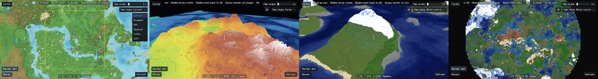

## Why Voxy Map

- **Real block colours** — the map can now be drawn in each block's actual colours, and this is the default style; for now only vanilla blocks are covered, mod support is planned.
- **See the whole world at a glance** — the map is built directly from the LOD data Voxy has already stored, so opening it shows the entire explored world at once; nothing is loaded or generated while the map is open, and newly explored areas appear on the map as you play.
- **Opens fast, runs well** — the first open takes a few seconds, and each world keeps its own cache, so afterwards (even after restarting the game) it opens almost instantly; while the map is open, world rendering is paused so the frame rate goes to the map.
- **A 3D map you can orbit** — GPU-rendered terrain at a true 1:1 scale: middle-click switches, drag to orbit, scroll to zoom; it updates live and stays smooth.
- **Smooth animation** — the map scales in and out, wheel zoom anchors on the cursor, Space eases the view onto the player, leaving 3D plays a short rotation back to the flat map, and switching between 2D and 3D is seamless.
- **Works with your pack** — Fabric 26.2 / 26.1.2 and NeoForge 1.21.1; supports Voxy SeedGen, terrain mods and biome mods; 9 languages.
- **Looks good and is easy to tune** — seven palettes (default: the 200-colour **Block colours** material palette), contours, hillshade, water-depth shading, biome borders and labels, a right-click menu (copy / teleport / export PNG), per-world memory, and an in-game config screen where every option is explained.

## Screenshots

### Fullscreen map

Using the **Tectonic mod**'s "i use voxy btw" preset terrain, Voxy SeedGen distance 382 chunks, yellow box = real render distance:

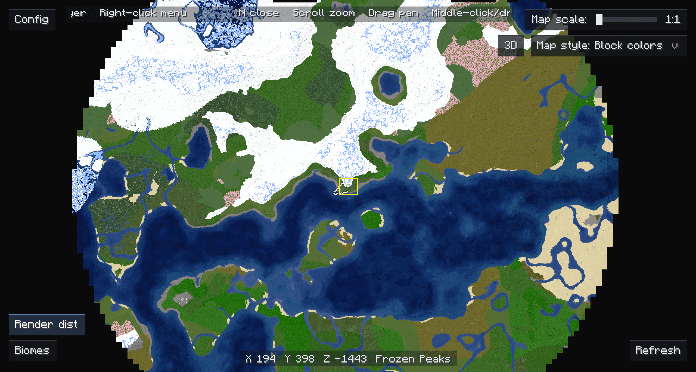

**Vanilla terrain**, Voxy SeedGen distance 382 chunks, yellow box = real render distance:

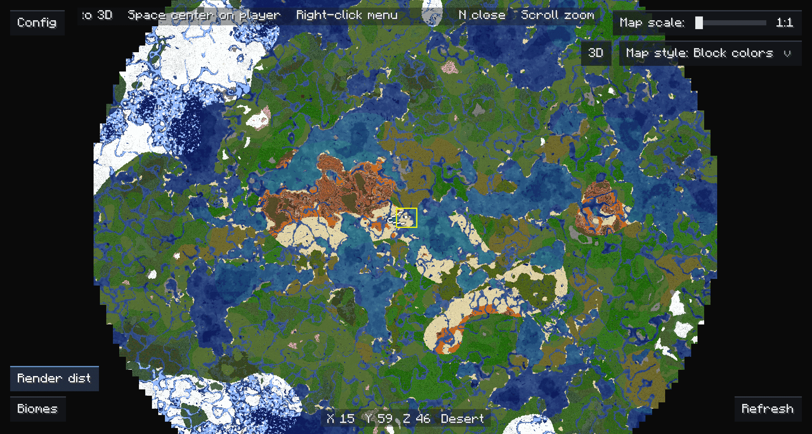

**Vanilla terrain**, Voxy SeedGen distance 382 chunks, yellow box = real render distance:

Close-up: contours, hillshade, water-depth shading, biome borders and labels:

3D mode:

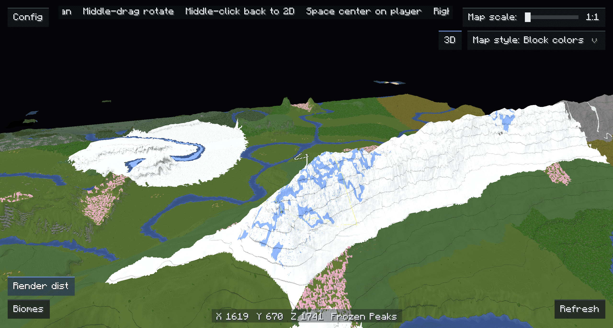

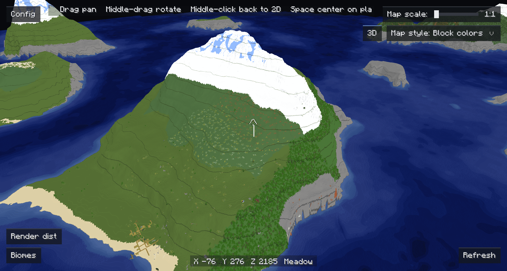

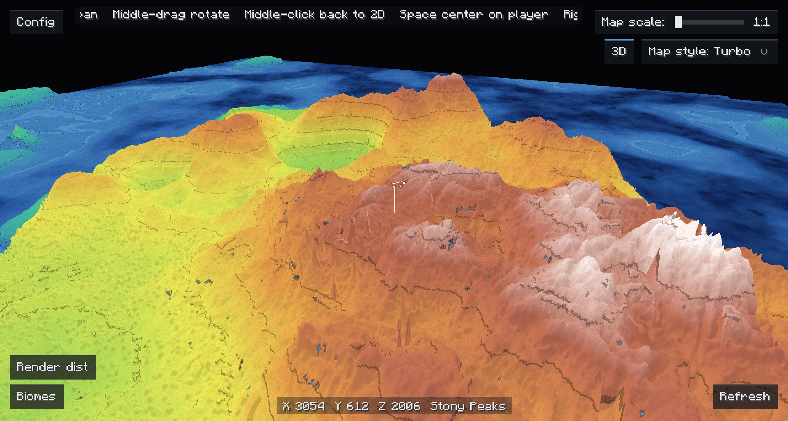

Config screen:

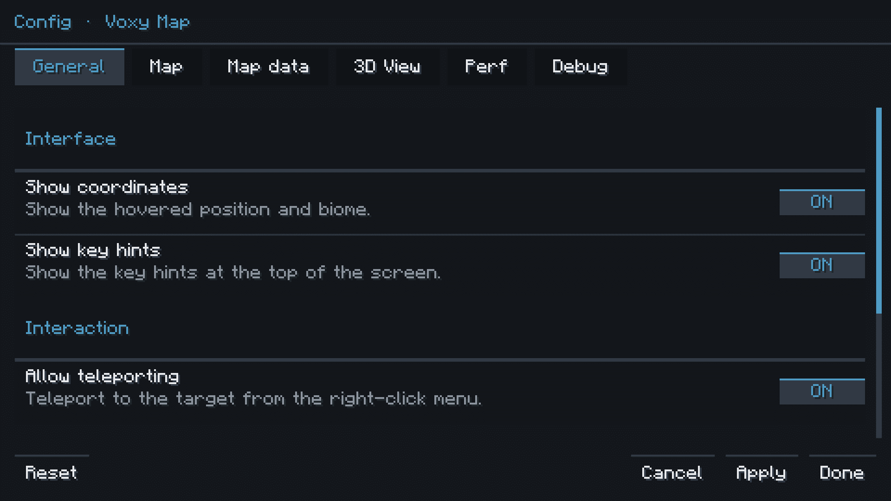

### Six palettes

Using the **Tectonic mod**'s "i use voxy btw" preset terrain, Voxy SeedGen distance 382 chunks, yellow box = real render distance (natural / gradient / GMT / nautical / gradient-turbo / gradient-soft):

## Quick start

| Build | Install |
| --- | --- |
| Fabric 26.2 | Fabric 26.2 + Fabric API + [Voxy](https://modrinth.com/mod/voxy) |
| Fabric 26.1.2 | Fabric 26.1.2 + Fabric API + [Voxy](https://modrinth.com/mod/voxy) |
| NeoForge 1.21.1 | NeoForge 21.1.224+ + [Voxy](https://modrinth.com/mod/voxy) + [Roxy](https://modrinth.com/mod/roxy) + Sodium |

- Download the matching jar from [Releases](https://github.com/Tsutsutsuu/voxy-map/releases), drop it into `mods/`, launch the game and press **N**.
- The first open takes about 10–20 s depending on the explored area; after that each world is cached and reopens in 1–2 s, and opening/closing inside one session is instant.

## Controls

| Action | Default |
| --- | --- |
| Open / close map | `N` |
| Re-centre on the player | `Space` |
| Zoom | Mouse wheel |
| Pan | Hold left mouse button and drag |
| Switch 2D ↔ 3D | Middle-click, or the **3D** button |
| Orbit the 3D camera | Hold middle mouse button and drag |
| Map menu | Right mouse button (copy coordinates / teleport / export PNG) |
| Debug panel | `Q` |
| Close | `Esc` |

## Compatibility

- **9 languages**: English, 简体中文, 繁體中文, 日本語, Русский, Deutsch, Français, Español, Português (BR); all text is translatable, so resource packs can override or add languages.
- **Terrain mods**: the sea level and colour range are read from the world's actual data, so custom terrain keeps the right coastline and colour spread (the screenshots use Tectonic terrain).
- **Biome mods**: biome names and borders come from the data stored for the world, and modded biomes follow the game language.
- Client-side only — nothing needs to be installed on the server.

## Configuration

Everything is in the in-game config screen, and every option is explained there. You can also edit the file directly: Fabric `config/voxymap-client.json`, NeoForge `config/voxymap-client.toml`. The config only sets defaults for new worlds; each world remembers its own palette, overlays, map scale and zoom.

The complete option list is in **[TECHNICAL.md](TECHNICAL.md#config-reference)**.

## FAQ

- **The map only covers part of the world / the edges are black?** Voxy is missing (NeoForge also needs Roxy), or SeedGen is not installed and the map only covers what Voxy actually stored. Black edges mean "no data", not a rendering error.
- **The map looks wrong right after opening?** It corrects itself once loading finishes; if it still looks wrong, click **Refresh** in the bottom-right corner.
- **Frame rate feels low?** Keep `skipWorldRender` on (it is by default); turning off the biome overlay or using a coarser map scale also helps.
- **Only part of the map's tiles show up?** This is most likely the VRAM budget; adjust it in the config screen to match your GPU's memory.

## Known limitations

- Currently overworld only — the Nether and the End are not drawn.
- Biomes are matched by registry name, so identically named biomes from different mods may rarely collide.

Implementation details, the full option list and build instructions: **[TECHNICAL.md](TECHNICAL.md)**.

## Support

- Issues and suggestions: <https://github.com/Tsutsutsuu/voxy-map/issues>
- Map data: [Voxy](https://modrinth.com/mod/voxy) · distant pre-generation: [Voxy SeedGen](https://modrinth.com/mod/voxy-seedgen)

## License

MIT — see [LICENSE](LICENSE). Icon and screenshots © Tsutsutsuu.

---

# 简体中文

[English](#voxy-map) | **[简体中文](#简体中文)**

> ***所见即所得*** —— 能看多远，地图就画多远。
> 直接把 Voxy 已有的 LOD 数据变成一张实时地图：**不加载区块、不生成地形**，能看到的世界就是一张 3D 地图。

纯客户端模组，支持 **Fabric 26.2 · Fabric 26.1.2 · NeoForge 1.21.1**。

配合 **Voxy SeedGen** 使用效果最佳 —— 它按世界种子预生成远景数据，就算没有真正加载过区块，也能绘制地图：
<https://modrinth.com/mod/voxy-seedgen>

## 亮点

- **新的按方块实际颜色着色** —— 现在已经支持按照方块实际颜色绘制地图，已经设为默认配置，暂时只支持原版方块，Mod支持计划中。
- **一眼看完整张地图** —— 地图直接用 Voxy 已经存下的 LOD 数据构建，打开就是整片探索过的世界；开图期间不加载、不生成任何东西，之后探索到的新区域也会实时出现在地图上。
- **开得快，性能好** —— 首次打开几秒出图，每个世界都有自己的缓存，之后（包括重启游戏后）几乎秒开；开图时世界渲染会暂停，帧率全留给地图。
- **能环绕的 3D 地图** —— GPU 渲染、按真实 1:1 渲染的地形：中键拖动就能切换；拖动环绕、滚轮缩放，实时刷新，性能好。
- **动画顺滑** —— 开关图有缩放动画、滚轮以鼠标为锚点平滑缩放、空格缓动定位到玩家、退出 3D 时短暂旋转回平面地图，2D 模式和 3D 模式之间无缝切换。
- **兼容你的整合包** —— Fabric 26.2 / 26.1.2 与 NeoForge 1.21.1 都能用；支持 Voxy SeedGen、地形模组和群系模组；9 种语言。
- **好看也好调** —— 7 套配色（默认：**方块颜色**的 200 色材质色表）、等高线、山体阴影、水深着色、群系边界与标签、右键菜单（复制 / 传送 / 导出 PNG）、每个世界独立记忆，以及每项都有说明的游戏内配置屏。

## 截图

### 全屏地图

使用 **Tectonic Mod** 的 "i use voxy btw" 预设地形，Voxy SeedGen 距离 382 区块，黄色框为真实渲染距离：

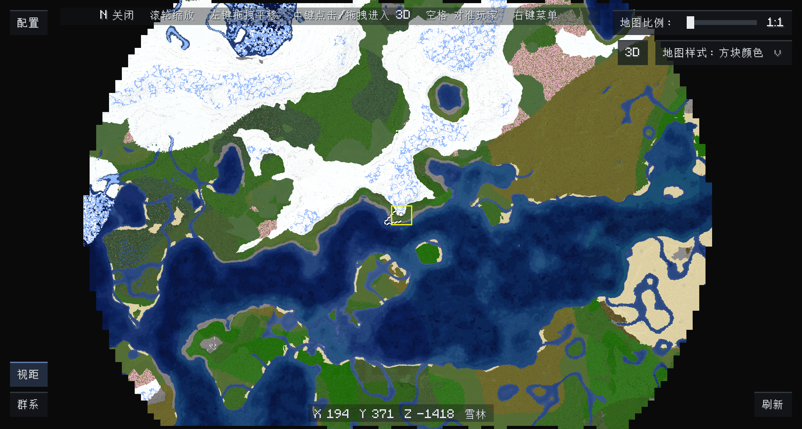

**原版地形**，Voxy SeedGen 距离 382 区块，黄色框为真实渲染距离：

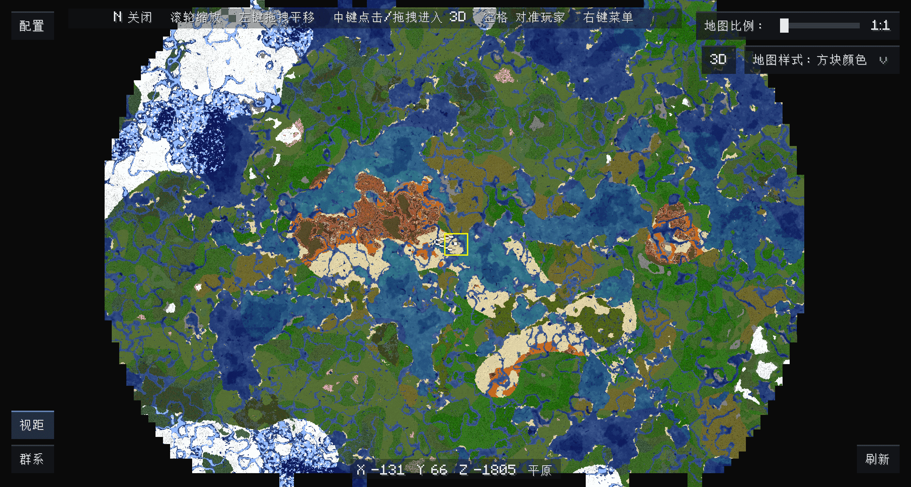

**原版地形**，Voxy SeedGen 距离 382 区块，黄色框为真实渲染距离：

近景细节：等高线、山体阴影、水深着色、群系边界与标签：

3D模式：

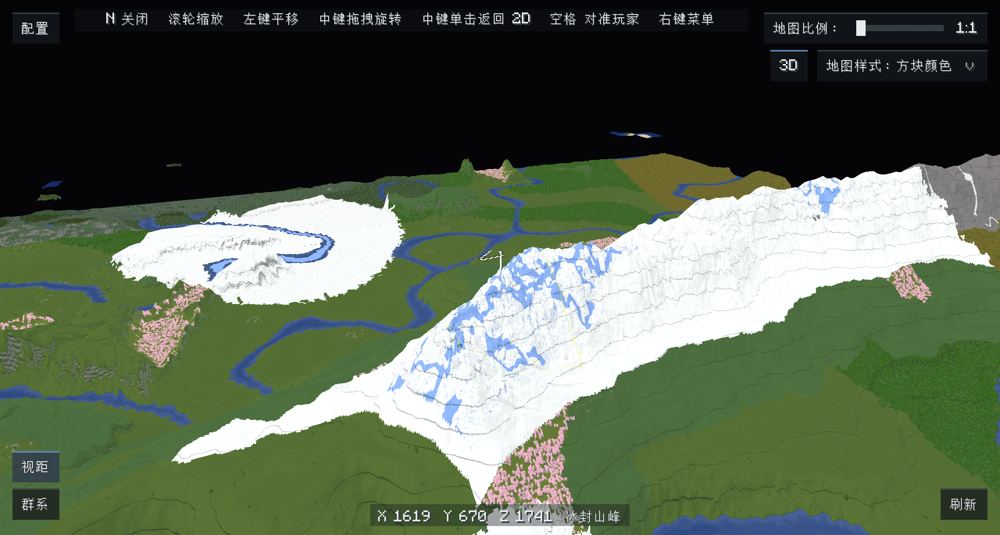

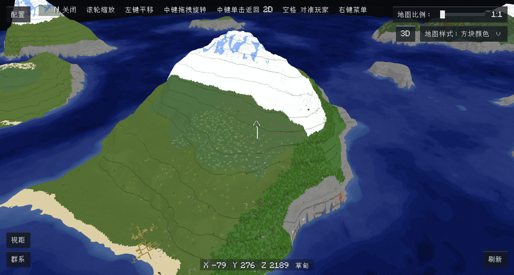

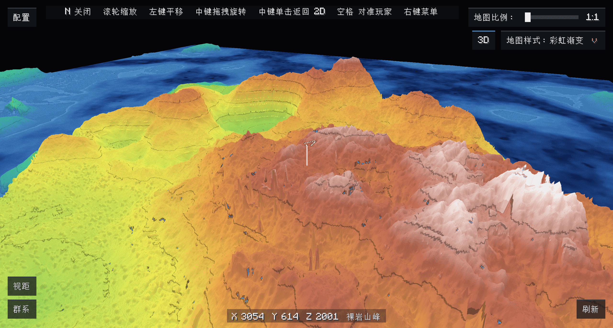

配置界面：

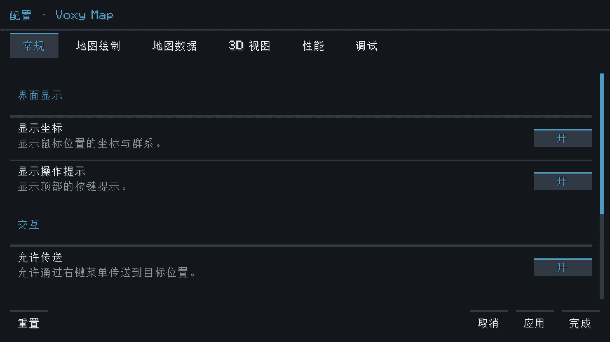

### 6 种配色

使用 **Tectonic Mod** 的 "i use voxy btw" 预设地形，Voxy SeedGen 距离 382 区块，黄色框为真实渲染距离（自然地形 / 渐变 / GMT / 航海 / 彩虹渐变 / 柔和渐变）：

## 快速开始

| 构建 | 需要安装 |
| --- | --- |
| Fabric 26.2 | Fabric 26.2 + Fabric API + [Voxy](https://modrinth.com/mod/voxy) |
| Fabric 26.1.2 | Fabric 26.1.2 + Fabric API + [Voxy](https://modrinth.com/mod/voxy) |
| NeoForge 1.21.1 | NeoForge 21.1.224+ + [Voxy](https://modrinth.com/mod/voxy) + [Roxy](https://modrinth.com/mod/roxy) + Sodium |

- 从 [Releases](https://github.com/Tsutsutsuu/voxy-map/releases) 下载对应 jar，放进 `mods/`，启动游戏，按 **N**。
- 首次打开约 10–20 秒（取决于探索范围）；之后每个世界有缓存，重开 1–2 秒，同一游戏进程内反复开关是瞬时的。

## 操作

| 操作 | 默认键 |
| --- | --- |
| 打开 / 关闭地图 | `N` |
| 对准玩家 | `Space` |
| 缩放 | 鼠标滚轮 |
| 平移 | 按住鼠标左键拖拽 |
| 2D ↔ 3D 切换 | 中键短按，或右上角 **3D** 按钮 |
| 3D 环绕 / 旋转 | 按住鼠标中键拖拽 |
| 地图菜单 | 鼠标右键（复制坐标 / 传送 / 导出 PNG） |
| 调试面板 | `Q` |
| 关闭地图 | `Esc` |

## 兼容性

- **9 种语言**：English、简体中文、繁體中文、日本語、Русский、Deutsch、Français、Español、Português (BR)；所有文本都可翻译，资源包可以覆盖或新增语言。
- **地形模组**：海平面与高度色带都按世界实际数据来，自定义地形也能保持正确的海岸线和配色层次（截图使用 Tectonic 地形）。
- **群系模组**：群系名称与边界来自世界存下的数据，模组群系会跟随游戏语言显示。
- 纯客户端模组，不需要安装在服务端。

## 配置

所有选项都在游戏内配置屏里，每项都有说明。也可以直接编辑配置文件：Fabric 为 `config/voxymap-client.json`，NeoForge 为 `config/voxymap-client.toml`。配置只决定新世界的默认值，每个世界会记住自己的配色、叠加层、地图比例与缩放。

完整选项说明见 **[TECHNICAL.md](TECHNICAL.md#配置参考)**。

## 常见问题

- **地图只覆盖了一部分 / 边缘是黑的？** 没装 Voxy（NeoForge 还需要 Roxy），或者没装 SeedGen，地图只覆盖 Voxy 已存下的数据——黑边是「没有数据」，不是渲染错误。
- **刚打开地图地图有错误？某些区块加载不出来？** 等加载完之后会自动修正，如果还是没修正，点右下角刷新就好。
- **帧率偏低？** 保持 `skipWorldRender` 开启（默认就是开）；关闭群系叠加、把地图比例调粗也能减负。
- **只能显示一部分地图瓦片？** 大概率是显存预算的限制原因，可以根据自己显存容量在配置界面调整。

## 已知限制

- 暂时仅支持主世界——下界、末地不绘制。
- 群系按注册名匹配，不同模组的同名群系极少情况下可能显示错误。

实现细节、完整配置表与构建方式见 **[TECHNICAL.md](TECHNICAL.md)**。

## 支持

- 问题与建议：<https://github.com/Tsutsutsuu/voxy-map/issues>
- 地图数据来自 [Voxy](https://modrinth.com/mod/voxy)；远景预生成来自 [Voxy SeedGen](https://modrinth.com/mod/voxy-seedgen)。

## 许可证

MIT，详见 [LICENSE](LICENSE)。图标与截图 © Tsutsutsuu。

